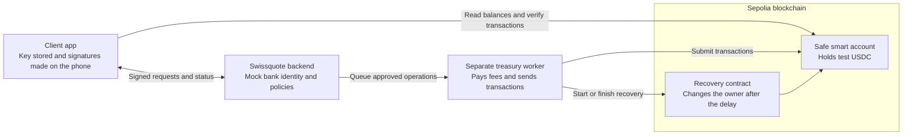
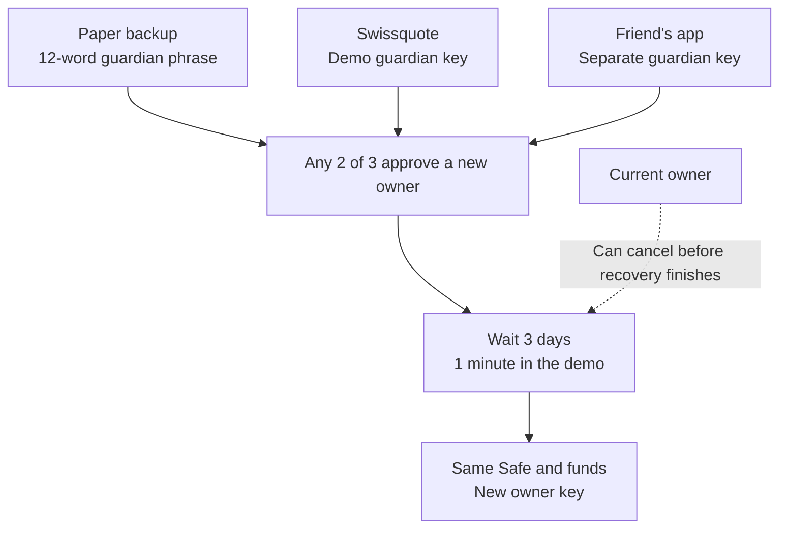

# Swissquote Wallet

A mobile wallet where the client keeps their spending key and Swissquote helps with funding, fees and recovery. Funds live in a **Safe smart account**. If the phone is lost, any **two of three guardians** can restore access.

Built for the **BSA Hackathon — Build the Swissquote Wallet** track. The prototype uses **Ethereum Sepolia** (`11155111`) and test USDC. The previous README is preserved in [PLAN.md](PLAN.md) as a historical plan.

## What works

| Feature                   | What it does                                                                                                |
| ------------------------- | ----------------------------------------------------------------------------------------------------------- |
| Create a wallet           | Generates a key on the phone and deploys a Safe.                                                            |
| Protect the wallet        | Sets up a paper backup, Swissquote and a friend as guardians.                                               |
| Prove wallet control      | Checks a signed message and the Safe's current owner on-chain.                                              |
| Add money and send        | Transfers test USDC; Swissquote's treasury pays the network fees. Send also accepts recipient QR codes.     |
| Recover access            | Replaces a lost owner key after two guardian approvals and a waiting period. Keeps the same Safe and funds. |
| Cancel or update recovery | The current owner can cancel recovery, invalidate old approvals or replace guardians.                       |
| Recovery alerts           | Shows recovery requests and deadlines inside the app.                                                       |

## Mocked

| Part                       | What is mocked                                                                                         |
| -------------------------- | ------------------------------------------------------------------------------------------------------ |
| Bank login and KYC         | Demo identities; passwords are not checked, sent or stored.                                            |
| Bank account and funding   | A testnet treasury stands in for Swissquote's bank systems. Token transfers and fee payments are real. |
| Swissquote recovery review | A demo session, a previous signed wallet link and a confirmation flag replace a real identity review.  |
| Compliance                 | Address screening and high-value review decisions; no real sanctions or Travel Rule provider.          |

## Custody model and choices

The phone holds the only key used for everyday spending. The **Safe holds the assets**, so its address stays the same when recovery changes the owner.

Recovery uses three separate guardians: **paper backup, Swissquote and friend**. Any two can replace the owner after **three days**. Swissquote cannot move funds alone, but **Swissquote + friend can take control after the delay without the client**. The current owner can cancel if they still have their key.

| Choice                           | Why we chose it                                              | Main tradeoff                                                                  |
| -------------------------------- | ------------------------------------------------------------ | ------------------------------------------------------------------------------ |
| Safe + Candide recovery          | Existing contracts handle spending and owner replacement.    | EVM-only; contract bugs and guardian collusion remain risks.                   |
| Local spending key               | The client signs their own transactions.                     | A stolen usable key can spend immediately.                                     |
| Separate 12-word backup guardian | Keeps one recovery factor off the phone.                     | The phrase restores a guardian, not the spending key; it cannot recover alone. |
| Three-day delay                  | Gives the owner time to notice and cancel unwanted recovery. | Recovery takes time and alerts may be missed.                                  |
| Treasury-paid fees               | Clients do not need ETH for normal online operations.        | Requires a working backend, worker and funded treasury.                        |

We use established libraries for keys and signatures. A custodial wallet would give the bank full control; a seed-only wallet would depend on one backup. MPC would support more chains but needs separate signing infrastructure. This prototype uses smart-account recovery instead of MPC or split key shares.

## Architecture



The backend stores public wallet data and requests in SQLite. The separate worker keeps its own record of signed transactions so it can safely resume after a restart. Client private keys never go to the backend.

Swissquote's guardian uses a separate key file, but its signing still runs inside the API process. It is not an isolated key-share service.

### Guardians and recovery



Backup + friend can recover without Swissquote. The recovering phone or another payer needs ETH to submit the recovery directly on-chain.

### Stack and code

| Part                | Technology                          | Location                                                                                                                |
| ------------------- | ----------------------------------- | ----------------------------------------------------------------------------------------------------------------------- |
| Mobile app          | Expo 57, React Native, TypeScript   | [apps/mobile](apps/mobile)                                                                                              |
| Wallet logic        | viem, AbstractionKit                | [packages/wallet-core](packages/wallet-core)                                                                            |
| Bank API and worker | Python, FastAPI, SQLite             | [backend/app](backend/app)                                                                                              |
| Smart accounts      | Safe 1.4.1, Candide social recovery | [Safe configuration](packages/wallet-core/safe/account.ts), [recovery modules](packages/wallet-core/recovery/module.ts) |
| Optional contract   | Solidity high-value guard           | [contracts/src/HighValueGuard.sol](contracts/src/HighValueGuard.sol)                                                    |
| Tests and tools     | Vitest, pytest, local EVM           | [tests](tests), [backend/tests](backend/tests), [scripts](scripts)                                                      |

The normal app uses treasury-paid Safe transactions. ERC-4337 remains an alternative code path; the normal flow needs no bundler or paymaster. Bitcoin is not supported.

## Wallet creation, signing and recovery

### Create and protect

1. Log in with a demo account and complete mock KYC.
2. Create the spending key on the phone. Review and sign the request to deploy the Safe.
3. Link it to the account by signing a short-lived message. The backend checks that the signer owns the Safe.
4. Write down the backup phrase, invite a friend and compare the verification words on both phones.
5. Confirm the three guardians. Protection is required before using the wallet and adding money.

Owner and friend keys use biometric-protected SecureStore. The backup phrase is not saved by the app or sent to the backend. Keys enter app memory during signing; they are not non-exportable hardware keys or passkeys.

### Sign and send

Review the recipient and amount, authenticate to read the protected key, then sign on the phone. The backend checks the signature and current owner before the treasury sends the transaction. The app checks the receipt, token transfer and balance changes after two confirmations.

Small and large transfers use the same authentication. Deposits and sends are capped at **10,000 test USDC** per operation. Larger requests are refused; there is no completed manual-review flow.

### Recover

A replacement phone creates a new owner key. Two guardians approve that key, then the recovery contract starts its waiting period. The current owner can cancel. After the deadline, recovery replaces the owner while keeping the same Safe and assets. The client must prove wallet control again before bank funding resumes.

Bank-assisted recovery requires a **previous signed link** between the account and Safe. Only the client who opened the case can request bank-paid start or finalization. Identity review is still mocked.

| What was lost?                        | Recovery pair                                   |
| ------------------------------------- | ----------------------------------------------- |
| Phone                                 | Backup + Swissquote, or backup + friend.        |
| Phone and paper backup                | Swissquote + friend.                            |
| Swissquote is unavailable             | Backup + friend, with an independent ETH payer. |
| Owner key and access to two guardians | Recovery is not guaranteed.                     |

## Optional high-value contract (not used right now in the app)

`HighValueGuard` can require a bank co-signature for large transfers and sensitive actions. It is tested separately but is not enabled in the mobile app.

Safe module calls can bypass this guard, including ERC-4337 and recovery. It is not a complete compliance control and can add dependence on the bank.

## Threat model

| Threat                                   | Risk                                            | Protection and remaining limits                                                                   |
| ---------------------------------------- | ----------------------------------------------- | ------------------------------------------------------------------------------------------------- |
| Usable owner key stolen                  | Immediate spending or cancellation of recovery. | Protected key storage and signing confirmation; recovery does not freeze funds.                   |
| Two guardians collude or are compromised | Take control after the delay.                   | Current owner can cancel if they still have their key and act in time.                            |
| Swissquote refuses service               | Online funding, fees or bank approval stop.     | Bank cannot spend alone; backup + friend can recover on-chain.                                    |
| Owner key lost and guardians unavailable | Permanent lockout.                              | Keep recovery factors separate and replace unavailable guardians while the owner key still works. |
| False requests or replay                 | Wrong transaction or repeated execution.        | Signed requests bind the Safe, chain, action and nonce; backend and client check live state.      |
| Treasury empty or worker unavailable     | Transactions and cancellation can be delayed.   | Stored requests and signed transactions allow retries; there is no emergency gas reserve.         |
| Contract or dependency bug               | Loss or unauthorized control.                   | Established libraries and tests; no claim of a completed independent security audit.              |
| Stolen demo session                      | Impersonation during bank-assisted recovery.    | Prior signed wallet link and guardian quorum help, but real identity review is missing.           |

## Limits

- **Bank-independent recovery is broader than the mobile UI.** The contracts support backup + friend, but fresh-phone login and existing online recovery cases still depend on the API. Normal mobile sending uses the bank relay.
- **Logout removes the owner key from that phone.** Returning to the same wallet requires recovery. Reset also removes its friend-guardian key; neither action changes on-chain funds.
- The phone's wallet is tied to one demo username until logout/reset. This prevents accidental account switching, not identity fraud.
- Recovery alerts work in-app; mobile background push is not complete. Stolen-phone-and-email attacker refusal is not demonstrated.
- Use one treasury worker. Keep its database and signed-transaction records across restarts. Unsigned relays retry temporary RPC or treasury-gas shortages for up to 15 minutes, then fail. Invalid operations can fail immediately; signed transactions keep reconciling.
- A signed Safe authorization has no built-in expiry. A timeout does not prove the transaction failed.
- Funded public-Sepolia wallet acceptance and physical-device biometric testing still need confirmation. The one-minute module is configured; existing local contract tests cover three-minute and three-day recovery.

## Legal part

The client controls everyday spending, and Swissquote cannot move funds alone. However, Swissquote and another guardian can replace the owner together. We therefore cannot assume the wallet legally counts as software with no custody role. A legal review must consider those recovery powers and how client assets are protected. [FINMA custody guidance](https://www.finma.ch/en/~/media/finma/dokumente/dokumentencenter/myfinma/4dokumentation/finma-aufsichtsmitteilungen/20260112-finma-aufsichtsmitteilung-01-2026.pdf).

For relevant bank transfers, FINMA requires technical proof of wallet ownership alongside identity checks. Our signed message and on-chain owner check provide evidence of wallet control. KYC is mocked, and this proof alone is not full Travel Rule compliance. [FINMA blockchain-payment guidance](https://www.finma.ch/~/media/finma/dokumente/dokumentencenter/myfinma/4dokumentation/finma-aufsichtsmitteilungen/20190826-finma-aufsichtsmitteilung-02-2019.pdf?sc_lang=en).

| Transfer             | Current approach                                                                                                                     |
| -------------------- | ------------------------------------------------------------------------------------------------------------------------------------ |
| Bank → wallet        | Signed funding consent, mock KYC and current wallet-control check.                                                                   |
| Wallet → bank        | No implemented redemption or withdrawal-to-bank flow.                                                                                |
| Wallet → third party | Client signs; Swissquote relays and pays fees. Its legal role needs review. No real Travel Rule information exchange is implemented. |

## Business case

Swissquote keeps a connection with clients who would otherwise move to another wallet for self-custody. Clients keep control of their spending key while using familiar funding and recovery support. Swissquote could benefit from retained trading and funding activity, or offer paid recovery support. These are business hypotheses, not proven revenue. Measure client retention, wallet usage and transfer volume against gas, support and identity-review costs.

## Run the prototype

Use **Node 24** and **Python 3.11+**. Run commands from the repository root unless stated otherwise.

### 1. Install and create the demo keys

```bash
npm ci
python3 -m venv backend/.venv
backend/.venv/bin/python -m pip install -r backend/requirements-dev.txt
PYTHONPATH=backend backend/.venv/bin/python -m app.funding.setup
PYTHONPATH=backend backend/.venv/bin/python -m app.guardian_policy.signer init
cp apps/mobile/.env.example apps/mobile/.env
```

Setup creates `backend/.env` and prints the treasury address. Fund that address with **Sepolia ETH and test USDC**. Keep the generated keys and data when restarting.

### 2. Configure the app

In `backend/.env`, set `MOCK_KYC_STATUS=verified` for the demo. Keep the generated `MOCK_ACCESS_TOKEN` and treasury settings.

In `apps/mobile/.env`, change:

| Setting                         | Value                                          |
| ------------------------------- | ---------------------------------------------- |
| `EXPO_PUBLIC_API_BASE_URL`      | `http://<your-computer-LAN-IP>:8000`           |
| `EXPO_PUBLIC_DEMO_ACCESS_TOKEN` | The same value as backend `MOCK_ACCESS_TOKEN`. |

Keep the other defaults from [.env.example](apps/mobile/.env.example). Use `demo-user` to log in. The password is a demo field. The token is bundled in the app: never use a real bank credential or put private keys in `EXPO_PUBLIC_*`.

For a **one-minute recovery demo**, set backend `RECOVERY_ALLOW_DEMO=true` and mobile `EXPO_PUBLIC_RECOVERY_PERIOD=demoOneMinute`. Use a fresh Safe; changing the setting does not change an existing Safe's delay. Normal recovery remains three days.

For multiple named demo accounts, enable both backend `MOCK_ALLOW_USERNAME_LOGIN=true` and mobile `EXPO_PUBLIC_DEMO_USERNAME_LOGIN=true`.

### 3. Run the server and app

Open three terminals in the repository root.

**Terminal 1 — API server:**

```bash
backend/.venv/bin/python -m uvicorn app.main:app --app-dir backend --host 0.0.0.0 --port 8000
```

**Terminal 2 — treasury worker:**

```bash
PYTHONPATH=backend backend/.venv/bin/python -m app.funding.worker
```

**Terminal 3 — mobile development server:**

```bash
npm run mobile -- --lan
```

The phone and computer must share a network. Health: `http://<your-computer-LAN-IP>:8000/health`. API schemas: `/docs`. Restart the mobile server after changing its environment settings.

### 4. Install a native build

For iOS, use a Mac with Xcode, CocoaPods and a signing team:

```bash
cd apps/mobile
npx expo run:ios --device
```

For Android, from the root with an Android toolchain:

```bash
npm run mobile:android
```

Enroll device biometrics and allow camera/local-network access. Web and Expo Go previews do not validate protected signing.

## API

| Routes                                                                                                       | Purpose                                             |
| ------------------------------------------------------------------------------------------------------------ | --------------------------------------------------- |
| `/auth/me`, `/auth/demo/login`                                                                               | Mock profile and optional username login.           |
| `/wallets/register`, `/wallets/link/challenge`, `/wallets/link/complete`, `/wallets/link/status`             | Register the Safe and prove current wallet control. |
| `/bank/account`, `/bank/funding/intents`, `/bank/funding/intents/{id}`, `/bank/funding/intents/{id}/confirm` | Test balance, deployment and deposit requests.      |
| `/transactions/relay`, `/transactions/{id}`                                                                  | Submit signed operations and check status.          |
| `/guardians/swissquote`, `/guardians/invites`, `/guardians/invites/{id}/accept`                              | Find the bank guardian and invite a friend.         |
| `/recovery/requests`, `/recovery/requests/{id}/approvals`, `/recovery/requests/{id}/swissquote-approve`      | Open a recovery case and collect approvals.         |
| `/recovery/requests/{id}/submit`, `/recovery/requests/{id}/finalize`                                         | Request bank-paid recovery start and completion.    |
| `/wallets/{safe}/recovery-status`, `/me/wallet`                                                              | Recovery state and original-wallet lookup.          |
| `/transactions/screen`, `/bank/transfers/authorize`                                                          | Mock compliance and bank authorization previews.    |

## Testing

Run the standard checks:

```bash
npm test
npm run typecheck
npm run lint
npm run format:check
backend/.venv/bin/python -m pytest backend/tests -q
backend/.venv/bin/ruff check backend
backend/.venv/bin/ruff format --check backend
```

To include local smart-contract tests, start the fixture in a separate terminal:

```bash
npm install --prefix /tmp/swissquote-funding-evm --no-audit --no-fund ganache@7.9.2 solc@0.8.30 @openzeppelin/contracts@5.4.0
node scripts/funding-evm-fixture.cjs
```

Then run:

```bash
FUNDING_EVM_FIXTURE=/tmp/swissquote-funding-evm/fixture.json backend/.venv/bin/python -m pytest backend/tests -q
```

The fixture needs network access to fetch contract code; it uses local test funds. Without it, those tests are skipped.

## Track coverage

| Required topic    | Our approach                                                                      |
| ----------------- | --------------------------------------------------------------------------------- |
| Custody model     | Local spending key, any-two guardian recovery and clear joint-control risks.      |
| Architecture      | Client app, bank backend, separate treasury worker and on-chain Safe/recovery.    |
| Wallet creation   | Phone-generated key, Safe deployment and signed account link.                     |
| Authentication    | Protected-key read before signing; same authentication for all transfer sizes.    |
| Recovery          | Three guardians, delay, cancellation and a bank-independent contract path.        |
| Business case     | Client retention, funding/trading activity and possible recovery-support revenue. |
| Legal feasibility | Wallet-control proof, custody-role review and honest Travel Rule limits.          |
| AI disclosure     | Tools and roles listed below.                                                     |

## Bonuses

### Gasless transactions

Implemented: Swissquote's treasury pays fees for deployment, funding, sending and online recovery. Client and Safe need no ETH. Signatures, allowed operations, transfer caps and one active request per Safe limit abuse. Daily sponsorship budgets and production rate limits are not implemented. Offline recovery needs another ETH payer.

### Compliant dApp interaction

Not completed. The prototype limits relayed calls and has mock screening, but no dApp browser, real sanctions checks or general DeFi transaction preview.

## AI tools used

| Tool                     | Use                                                |
| ------------------------ | -------------------------------------------------- |
| Codex                    | Development, testing, debugging and documentation. |
| Claude                   | Development, testing, debugging and documentation. |
| ChatGPT                  | Planning and research.                             |
| ChatGPT image generation | Logo generation.                                   |
