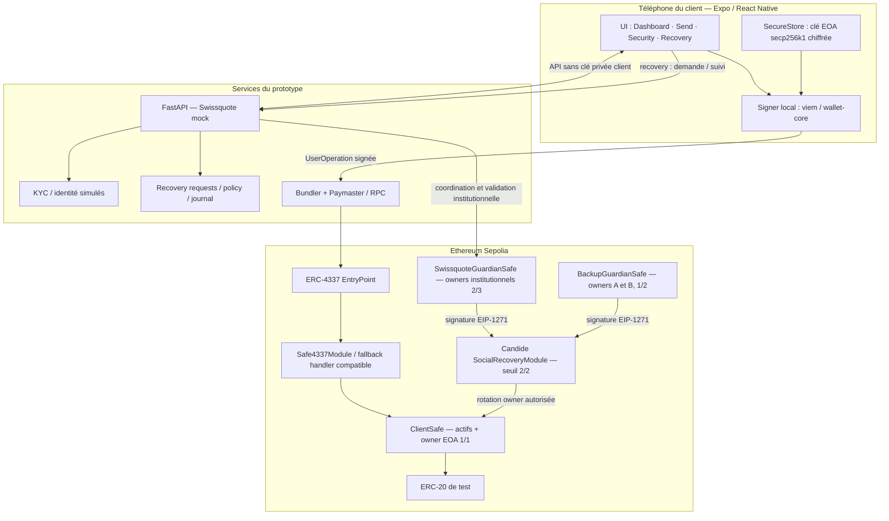

# Swissquote Self-Custody Wallet

> **BSA Hackathon — Swissquote Wallet Challenge**  
> **Statut :** architecture cible du prototype, avec intégrations critiques à valider sur testnet.  
> **Plateformes :** iOS / Android · **Réseau cible :** Ethereum Sepolia (`chainId: 11155111`).  
> **Langues :** application et pitch potentiellement en anglais ; documentation technique en français.

## Sommaire

1. [Vision et périmètre](#1-vision-et-périmètre)
2. [Décisions d'architecture](#2-décisions-darchitecture)
3. [Architecture générale](#3-architecture-générale)
4. [Tech stack détaillée](#4-tech-stack-détaillée)
5. [Modèle de custody et gestion des clés](#5-modèle-de-custody-et-gestion-des-clés)
6. [Organisation des comptes Safe et des guardians](#6-organisation-des-comptes-safe-et-des-guardians)
7. [Recovery obligatoire avec Swissquote](#7-recovery-obligatoire-avec-swissquote)
8. [Pertes, compromissions et rotation des guardians](#8-pertes-compromissions-et-rotation-des-guardians)
9. [Flux produit et blockchain](#9-flux-produit-et-blockchain)
10. [Backend et API](#10-backend-et-api)
11. [Sécurité, threat model et limites](#11-sécurité-threat-model-et-limites)
12. [UX et design mobile](#12-ux-et-design-mobile)
13. [Structure du monorepo](#13-structure-du-monorepo)
14. [Développement et configuration](#14-développement-et-configuration)
15. [Tests, critères d'acceptation et démonstration](#15-tests-critères-dacceptation-et-démonstration)
16. [Correspondance avec la track Swissquote](#16-correspondance-avec-la-track-swissquote)
17. [Plan de développement et répartition](#17-plan-de-développement-et-répartition)
18. [Risques techniques ouverts et plans de repli](#18-risques-techniques-ouverts-et-plans-de-repli)
19. [Références](#19-références)

---

## 1. Vision et périmètre

### Objectif

Créer une **wallet self-custodial intégrée à l'expérience Swissquote** : le client conserve le contrôle de ses actifs et de sa clé de signature, tout en profitant d'une application mobile simple et d'un **recovery assisté par Swissquote**.

La proposition de valeur est : **« Your keys. Your crypto. Swissquote by your side. »**

### Principes produit

- **Clé privée de dépense générée et conservée sur le téléphone du client**, jamais transmise au backend bancaire.
- **Safe Smart Account individuelle** : les cryptomonnaies du client résident à l'adresse de la Safe, pas à celle de l'EOA de signature.
- **Signature locale** avant chaque dépense, avec confirmation utilisateur.
- **Recovery sans seed phrase obligatoire pour l'owner EOA** : remplacement de cet owner par une nouvelle EOA, via un module social recovery.
- **Swissquote obligatoirement impliquée dans le recovery**, mais **incapable de le réaliser seule**.
- **Gasless ERC-20** via ERC-4337 + paymaster lorsque le sponsoring est disponible.
- **Architecture bancaire crédible** : contrôle d'identité renforcé, suivi, traçabilité et compliance ; intégrations bancaires **simulées** pour le hackathon.
- **UX mobile premium** ; la complexité EOA/Safe/4337 reste cachée dans le parcours courant.

### Parcours de démonstration prioritaire

`Create → Protect → Fund → Sign & Send → Lose Access → Recover → Sign again`

### Hors périmètre initial

Swaps, NFTs, multi-chain, navigateur dApps complet, infrastructure bancaire réelle, moteur AML/KYC certifié, audit de smart contracts, publication sur les stores.

### Avertissement

Il s'agit d'un **prototype sur testnet**, non d'une application bancaire ou d'un gestionnaire de clés prêt pour des fonds réels. Les modules existants doivent être revus, correctement configurés et testés. Aucun résultat juridique ou réglementaire n'est présumé acquis.

---

## 2. Décisions d'architecture

| Sujet | Décision | Statut |
|---|---|---|
| Distribution | Application mobile iOS/Android | **Retenu** |
| Framework | React Native + Expo (Development Build) | **Retenu** |
| Frontend | TypeScript, Expo Router, NativeWind, Reanimated | **Retenu** |
| Backend | Python + FastAPI | **Retenu** |
| Clé client | EOA Ethereum `secp256k1`, générée localement | **Retenu** |
| Stockage | Expo SecureStore : Keychain iOS / Android Keystore-backed encrypted storage | **Retenu** |
| Wallet qui reçoit les fonds | Safe Smart Account | **Retenu** |
| Owner ordinaire Safe client | EOA client, seuil `1/1` | **Retenu** |
| Recovery principal | Swissquote **ET** (Guardian A **OU** Guardian B) | **Exigence fonctionnelle** |
| Implémentation recovery cible | Social Recovery Candide à seuil `2/2` avec **deux guardians contractuels** | **POC obligatoire** |
| Guardian institutionnel | `SwissquoteGuardianSafe`, multisig interne `2/3` | **Architecture cible** |
| Guardian secondaire | `BackupGuardianSafe`, multisig `1/2` (A ou B) | **Architecture cible** |
| Exécution | ERC-4337 / `UserOperation` | **Cible MVP** |
| SDK AA | `abstractionkit` (Candide) ; SDK Safe en repli | **Compatibilité Expo à valider** |
| Recovery SDK | Social Recovery Module Candide | **Compatibilité signatures EIP-1271 à valider** |
| Token démo | USDC de test ou ERC-20 explicitement identifié comme test | **Cible MVP** |
| Réseau | Sepolia | **Retenu** |
| Base de données | SQLite pour métadonnées de prototype | **Retenu** |

**Contrainte essentielle :** `Swissquote AND (A OR B)` **n'est pas équivalent** à un seuil standard `2/3` sur `[Swissquote, A, B]`, car ce dernier accepterait `A + B` sans la banque.

---

## 3. Architecture générale



> **Note technique :** les flèches depuis les guardians contractuels illustrent **des vérifications de signatures ERC-1271**, pas un transfert de clés. La production concrète des signatures Safe imbriquées et leur acceptation par Candide doivent être démontrées sur Sepolia. Le diagramme représente l'architecture cible, pas une intégration déjà validée.

### Acteurs et pouvoirs

| Acteur | Possède / contrôle | Ne peut pas faire seul |
|---|---|---|
| **Client** | EOA locale ; owner normal de sa Safe | Récupérer une EOA perdue directement ; il doit passer par le recovery si l'ancienne clé est inaccessible |
| **ClientSafe** | ETH / tokens ; vérification des owners ; modules autorisés | Signer elle-même avec une clé privée (elle n'en a pas) |
| **Swissquote** | Service bancaire simulé et participation institutionnelle au recovery | Dépenser depuis la Safe du client ; réaliser seule le recovery configuré |
| **Guardian A / B** | Une clé indépendante chacun ; contrôle alternatif de la BackupGuardianSafe | Dépenser depuis ClientSafe ou récupérer sans Swissquote |
| **Bundler / Paymaster** | Transmission de UserOperations ; paiement éventuel des frais | Modifier une opération valablement signée sans en invalider les autorisations |

### Deux adresses à distinguer

- **EOA du client** : adresse de signature personnelle, normalement sans actifs du client.
- **ClientSafe** : adresse publique de réception et de détention des actifs. C'est l'adresse affichée dans `Receive` et utilisée pour lire les soldes.

---

## 4. Tech stack détaillée

### 4.1 Application mobile

| Package / technologie | Responsabilité | Notes |
|---|---|---|
| `expo`, `react-native` | Runtime mobile iOS / Android | Pas de SwiftUI à apprendre pour l'UI |
| `typescript` | Code de l'app et de la couche blockchain | Typage strict recommandé |
| `expo-router` | Navigation / deep links / onboarding / récupération | Parcours à étapes |
| `nativewind` | Styles, thèmes, design tokens | Composants réutilisables |
| `react-native-reanimated` | Micro-interactions et animations | Éviter les animations pendant l'approbation cryptographique |
| `expo-secure-store` | Secret EOA au repos | Protection native du stockage, **pas de signature secp256k1 matérielle garantie** |
| `expo-crypto` | Entropie / octets aléatoires | Utiliser les API asynchrones / natives sûres ; **pas `Math.random`** |
| `expo-local-authentication` | UX biométrique complémentaire | Ne remplace pas la politique d'accès à SecureStore |
| Expo Development Build | Tests sur appareils réels, plugins natifs | Privilégier au seul Expo Go |

### 4.2 Blockchain et smart accounts

| Technologie | Responsabilité | Notes |
|---|---|---|
| Ethereum Sepolia | Réseau de démonstration | `chainId: 11155111` |
| Ethereum EOA (`secp256k1`) | Clé privée/signature du client | Génération locale |
| `viem` | Signature EOA, comptes, encodage ERC-20, RPC | Vérifier le fonctionnement sous Hermes/Metro |
| **Safe Smart Account** | Détention des actifs ; owners ; modules | `ClientSafe`, `SwissquoteGuardianSafe`, `BackupGuardianSafe` |
| **ERC-20** | Transferts de USDC de test | Vérifier contrat token + `decimals` |
| **ERC-4337** | UserOperations, EntryPoint, bundler | Requiert version Safe / module / EntryPoint compatible |
| **Safe4337Module** | Interface ERC-4337 du compte Safe | Safe v1.4.1+ suivant documentation officielle |
| `abstractionkit` | Construction de Safe/UserOperations, recovery | **Candidat prioritaire, non encore validé dans Expo** |
| Candide Social Recovery Module | Guardians, seuil, approbations, timelock, changement d'owner | Ne supporte pas nativement « Swissquote obligatoire » comme simple seuil plat |
| ERC-1271 | Validation des signatures produites par les Safes guardians | **POC déterminant** |
| Bundler / paymaster compatibles | Inclusion on-chain et sponsoring gas | Fournisseur à choisir, quotas / clés API côté serveur |
| `@safe-global/protocol-kit` / Relay Kit | Solution alternative SDK | Ne pas mixer des versions incompatibles |

### 4.3 Backend et outils

| Technologie | Responsabilité |
|---|---|
| `python` + `fastapi` | APIs du compte Swissquote simulé, demandes de récupération, policies |
| `pydantic` | Validation stricte des payloads |
| `sqlite` + couche ORM légère (optionnelle) | Dossiers de recovery, metadata, journal ; **aucun secret EOA** |
| `eth-account` (ou signer Ethereum compatible) | Signature des clés institutionnelles **de démo**, format à valider |
| `pytest` | Tests backend et de policies |
| Vitest / Jest | Tests TypeScript du module `wallet-core` |
| Git / GitHub | Versioning, PR, revue de code |
| RPC Sepolia + explorateur | Lecture des états et preuves des transactions |

**Convention :** fixer les versions exactes des packages et contrats dans le lockfile et `config/chains.ts`. Les noms de classes/SDK sont susceptibles de changer : conserver l'architecture, adapter l'API à la version retenue après POC.

---

## 5. Modèle de custody et gestion des clés

### 5.1 Clé normale du client

- **Type :** une clé privée EOA Ethereum `secp256k1`, 32 octets, valide dans le groupe secp256k1.
- **Création :** uniquement sur l'appareil, avec une source d'entropie cryptographiquement sûre. `expo-crypto.getRandomBytesAsync()` est préférable à toute API présentant un fallback non sécurisé en mode débogage. Utiliser une bibliothèque éprouvée pour valider la clé et dériver l'adresse.
- **Stockage :** `expo-secure-store`, en utilisant les protections pertinentes sur chaque OS ; sur iOS, étudier `WHEN_PASSCODE_SET_THIS_DEVICE_ONLY` avec un fallback UX explicite lorsque le code appareil n'est pas configuré.
- **Accès :** exiger l'authentification locale au moment de récupérer le secret si la plateforme et le flux testés le permettent (`requireAuthentication`).
- **Signature :** clé déverrouillée temporairement dans l'application ; signature du hash de l'opération Safe selon les spécifications et SDK utilisés.
- **Interdictions :** pas de secret dans AsyncStorage, SQLite, Redux persistant, logs, crash reports, analytique, variables `EXPO_PUBLIC_*`, sources Git, backend ou requêtes réseau.
- **Limite explicite :** la clé EOA peut transiter dans la mémoire JavaScript au moment de signer. SecureStore protège essentiellement le secret **au repos**, pas contre un bundle/appareil compromis. La clé `secp256k1` n'est pas automatiquement une clé Secure Enclave non exportable.
- **Sauvegarde :** pas de seed phrase obligatoire dans le MVP ; la continuité repose sur la disponibilité du **recovery**. Ne pas annoncer « récupération garantie ».

### 5.2 Conditions de perte d'accès

- Changement de biométrie, suppression du code de verrouillage, désinstallation, restauration d'un backup ou changement de téléphone peuvent invalider ou faire disparaître la clé SecureStore.
- Tester iOS et Android avec ces scénarios ; les règles exactes diffèrent.
- Sur Android, **exclure les entrées SecureStore des backups automatiques** lorsqu'une configuration de backup personnalisée est utilisée : elles seraient indéchiffrables après une réinstallation.
- Aucune authentification biométrique seule ne garantit la pertinence du montant et du destinataire signés ; afficher les détails de l'opération et empêcher la signature de payloads opaques.

### 5.3 Emplacement des autres clés

| Clé / donnée | Emplacement | Contrôle |
|---|---|---|
| EOA client | Téléphone du client, SecureStore | Client seul |
| Adresse EOA, adresse Safe | Blockchain + métadonnées backend | Publique |
| Safes guardians et leurs owners | On-chain | Configurées indépendamment |
| Clé interne banque #1/#2/#3 | Environnements/systèmes distincts ; **clés de test pour MVP** | Swissquote (simulation) |
| Clé Guardian A | Appareil ou wallet indépendant | Guardian A |
| Clé Guardian B | Appareil ou wallet indépendant de A et de l'EOA principale | Guardian B |
| Identités, dossiers, alertes | FastAPI + SQLite | Services simulés |

**Production envisagée :** gestion institutionnelle des clés par HSM/KMS, procédures internes, journal d'audit, révocation, contrôle d'accès, et séparation entre décision de conformité et permission cryptographique. Ces protections ne sont **pas** fournies automatiquement par le prototype.

---

## 6. Organisation des comptes Safe et des guardians

Nous utilisons trois rôles de **Safe distincts**.

### 6.1 `ClientSafe` — wallet du client

```yaml
ClientSafe:
  assets: ETH / ERC-20
  owners:
    - ClientEOA
  owner_threshold: 1
  recovery_module: Candide Social Recovery Module # POC requis
  recovery_guardians:
    - SwissquoteGuardianSafe
    - BackupGuardianSafe
  recovery_threshold: 2 # SUR 2 guardians contractuels
  network: Ethereum Sepolia
```

La Safe du client détient les actifs. L'owner normal du compte est uniquement l'EOA du client. Le recovery n'est **pas** une seconde clé de dépense ; son pouvoir dépend des fonctions et permissions du module activé.

### 6.2 `SwissquoteGuardianSafe` — approbation institutionnelle obligatoire

```yaml
SwissquoteGuardianSafe:
  assets: none_required
  owners:
    - SwissquoteKey1
    - SwissquoteKey2
    - SwissquoteKey3
  owner_threshold: 2 # 2/3 clés institutionnelles
  purpose: sign/validate authorized recovery requests
```

- Le guardian institutionnel **a une adresse contractuelle unique**, reconnue comme guardian par `ClientSafe`.
- Deux signataires internes sur trois peuvent faire autoriser une signature ERC-1271 pour une demande de recovery.
- La perte d'**une** clé institutionnelle ne rend pas Swissquote indisponible ; les deux autres peuvent autoriser sa rotation.
- En production : contrôles internes + clés isolées, **pas trois clés sur le même serveur**.
- MVP simplifié acceptable si nécessaire : **une EOA guardian Swissquote de test**, avec la limitation de résilience documentée ; évolution cible vers la Safe institutionnelle 2/3.

### 6.3 `BackupGuardianSafe` — au moins un guardian secondaire

```yaml
BackupGuardianSafe:
  assets: none_required
  owners:
    - GuardianA
    - GuardianB
  owner_threshold: 1 # 1/2 : A OU B
  purpose: co-approve recovery with Swissquote
```

- Guardian A et B détiennent chacun leur propre clé hors du téléphone principal du client.
- A **ou** B peut produire une approbation valide au nom de `BackupGuardianSafe`.
- Avec encore un owner secondaire disponible, le groupe peut remplacer le guardian secondaire ayant perdu sa clé.
- Les guardians secondaires ne sont **pas** owners de `ClientSafe`.

### 6.4 Règle d'autorisation effective

```text
Recovery autorisé = approbation(SwissquoteGuardianSafe)
                 ET approbation(BackupGuardianSafe)

SwissquoteGuardianSafe = 2 signatures bancaires sur 3
BackupGuardianSafe     = 1 signature parmi Guardian A et B
```

Table des résultats :

| Approvals | Autorisé ? | Raison |
|---|---:|---|
| Swissquote + A | ✅ | Banque présente + backup validé |
| Swissquote + B | ✅ | Banque présente + backup validé |
| Swissquote + A + B | ✅ | Plus que nécessaire |
| A + B, sans Swissquote | ❌ | Guardian banque manquant |
| Swissquote seule | ❌ | Guardian backup manquant |
| A seule / B seule | ❌ | Guardian banque manquant |
| 1 clé interne banque + A | ❌ | Banque ne valide pas son propre `2/3` |
| 2 clés internes banque + A | ✅ | Deux niveaux satisfaits |

### 6.5 Pourquoi des Safes imbriquées ?

Le module Candide standard vérifie un **nombre** de guardians approuvant la demande. Pour imposer qu'un des guardians soit toujours Swissquote, le `2/3` plat est insuffisant.

Notre variante utilise le module en `2/2` sur deux **identités contractuelles**. Chaque identité définit ensuite son propre seuil interne, vérifiable par **ERC-1271**.

**Hypothèse d'intégration à démontrer, pas garantie de compatibilité :** le contrat Candide vérifie les signatures avec `SignatureChecker.isValidSignatureNow`, qui peut appeler ERC-1271 pour une adresse contractuelle. Mais le SDK et la Safe guardian doivent produire et vérifier exactement les **signatures contractuelles**, le **hash de recovery**, l'éventuel **Safe message hash**, les **handlers** et les formats dynamiques attendus. La simple présence d'ERC-1271 dans les deux projets ne suffit pas à garantir un flux opérationnel.

**POC bloquant :** vérifier sur Sepolia que `multiConfirmRecovery(...)` accepte **la signature de `SwissquoteGuardianSafe` ET celle de `BackupGuardianSafe`**, puis que la rotation d'owner fonctionne après le délai.

### 6.6 Caractère « obligatoire » de Swissquote

Swissquote est **obligatoire pour les récupérations effectuées par la configuration de recovery ci-dessus**. Cela ne signifie **pas** nécessairement que le propriétaire de `ClientSafe` est techniquement incapable de modifier ou de désactiver ce mécanisme, s'il conserve les permissions habituelles d'un owner Safe.

Pour rendre Swissquote **immuable** comme guardian, il faudrait ajouter des restrictions contractuelles sur la reconfiguration (et vérifier leurs effets sur la self-custody). Ce n'est **pas** inclus dans le MVP. Le modèle retenu est donc **« guardian Swissquote requis pour ce parcours de recovery »**, pas **« Swissquote peut empêcher toute reconfiguration future par l'owner »**.

---

## 7. Recovery obligatoire avec Swissquote

### 7.1 Cas normal : téléphone principal perdu

```mermaid
sequenceDiagram
    actor Client
    participant App as Expo (nouveau téléphone)
    participant API as FastAPI / dossier bancaire simulé
    participant SQ as SwissquoteGuardianSafe (2/3)
    participant BG as BackupGuardianSafe (1/2)
    participant RM as SocialRecoveryModule
    participant Safe as ClientSafe

    Client->>App: Demande Recover Wallet
    App->>App: Génère EOA_B localement
    App->>API: Safe + nouvelle adresse EOA_B
    API->>API: Contrôle renforcé simulé / antifraude
    API->>SQ: Demande autorisation institutionnelle
    SQ-->>RM: Signature ERC-1271 valide (2/3 interne)
    Client->>BG: Contacte Guardian A ou B
    BG-->>RM: Signature ERC-1271 valide (1/2 interne)
    RM->>RM: 2/2 guardians validés ; ouvre timelock
    Note over RM: Délai testnet court ; délai production à définir
    RM->>Safe: Finalise la rotation EOA_A → EOA_B
    App->>Safe: Vérifie EOA_B owner + ancien EOA_A révoqué
```

1. Le client réinstalle l'app ou utilise un nouvel appareil.
2. Une **nouvelle EOA_B** est générée localement ; sa clé privée reste sur le nouvel appareil.
3. La demande inclut au minimum l'adresse `ClientSafe`, les nouveaux owners proposés, le nouveau seuil et le contexte réseau ; **le format exact signé est celui du module Candide**, non un payload inventé.
4. Swissquote effectue des **contrôles d'identité simulés mais renforcés**. L'accès à l'email ou à la session Swissquote seul ne suffit pas.
5. Deux signataires internes Swissquote autorisent la demande ; le guardian contractuel institutionnel fournit la preuve ERC-1271 attendue.
6. Guardian A **ou** B approuve la **même demande** via `BackupGuardianSafe`.
7. Le module vérifie les deux guardians, démarre une période d'attente, et permet éventuellement l'annulation par l'owner encore actif suivant les règles du module.
8. Après le délai, la demande est finalisée sur Sepolia : remplacement de l'ancienne EOA par la nouvelle.
9. L'app prouve que **l'adresse Safe et les actifs restent identiques**, que la nouvelle EOA est owner, et que l'ancienne ne peut plus autoriser de nouvelles opérations.

> **Important :** le recovery **n'empêche pas** automatiquement un voleur déjà titulaire de la clé EOA valide de dépenser avant l'achèvement de la rotation. Un timelock de recovery n'est pas un timelock de dépense.

### 7.2 Ce qui est réellement on-chain

- Configuration des owners et seuils de chaque Safe.
- Adresses des guardians enregistrées par le module.
- Validation cryptographique des approbations des guardians.
- Demande de recovery, état du délai, finalisation et rotation de l'owner.
- Transaction(s) réelles de démonstration depuis `ClientSafe`.

### 7.3 Ce qui peut être simulé

- Compte Swissquote, authentification bancaire et KYC renforcé.
- Contrôles antifraude humains et autorisation opérationnelle de signer du guardian institutionnel.
- Service de notification email/SMS, tableau de suivi et données bancaires.
- Screening sanctions/AML (à identifier comme simulation).

**La signature du recovery et la rotation d'owner ne doivent pas être uniquement simulées** dans l'interface du MVP final.

### 7.4 Politique Swissquote guardian

- Approuver uniquement une **demande de recovery**, pas une transaction arbitraire.
- Associer l'autorisation à une Safe particulière, une liste de nouveaux owners, un seuil et un nonce reconnus par le contrat.
- Vérifier le réseau et les adresses attendus, le dossier utilisateur, et l'état du module on-chain.
- Journaliser les approbations/refus et appliquer des contrôles anti-abus.
- Vérifier le format et le hash exacts produits par le module : **ne pas inventer un champ d'expiration on-chain si la version du module ne le vérifie pas** ; les délais administratifs seuls ne constituent pas une protection cryptographique.
- Séparer le décideur API du matériel/logiciel qui détient les clés institutionnelles.

---

## 8. Pertes, compromissions et rotation des guardians

### 8.1 Matrice de disponibilité

| Incident | Recovery encore possible ? | Action recommandée |
|---|---|---|
| Guardian A perd sa clé | **Oui** si B et Swissquote disponibles | B peut autoriser ; remplacer A |
| Guardian B perd sa clé | **Oui** si A et Swissquote disponibles | A peut autoriser ; remplacer B |
| A et B perdent leurs clés, EOA client encore valide | **Pas via backup actuel** ; client peut réorganiser la configuration | Recréer la BackupGuardianSafe / la remplacer en utilisant l'owner actif |
| A et B perdent leurs clés **et** EOA client perdue | **Non** sans secours préconfiguré | Blocage du recovery ; ne jamais promettre le contraire |
| Une clé interne Swissquote perdue | **Oui** si 2 autres clés valides | Rotation de cette clé dans SwissquoteGuardianSafe |
| Deux clés internes Swissquote perdues | **Non** via son `2/3` courant | Procédure de continuité institutionnelle préconfigurée requise |
| Swissquote opérationnellement indisponible | **Non** tant qu'une approbation institutionnelle n'est pas produite | Continuité d'activité et communication ; veto de fait |
| EOA client perdue ; Swissquote + A disponibles | **Oui**, après vérifications / timelock | Recovery normal |
| EOA client compromise ; Swissquote + B disponibles | **Peut-être**, si les fonds n'ont pas été transférés | Réagir en urgence ; le recovery ne fige pas la Safe |

### 8.2 Rotation d'un guardian secondaire

**Si l'owner principal fonctionne encore :** le client autorise une modification du module/recovery, dans les limites de ses permissions. Si le backup garde un owner (A ou B), ce dernier peut aussi remplacer l'owner secondaire perdu **à l'intérieur de `BackupGuardianSafe`**, après une transaction Safe valide. Vérifier les permissions et le timelock que l'on souhaite imposer à ces changements.

**Si l'owner principal est perdu mais A ou B fonctionne encore :** utiliser Swissquote + le guardian secondaire disponible pour récupérer `ClientSafe`, puis faire la maintenance des guardians.

**Si toutes les clés secondaires ET la clé principale ont disparu :** aucune approbation de `BackupGuardianSafe` n'est possible ; le recovery prévu échoue. L'application doit traiter cet état comme un risque irréversible.

### 8.3 Rotation institutionnelle

- Swissquote signe via une **Safe multisig institutionnelle** avec trois signers internes indépendants, seuil 2/3.
- Un signer perdu/compromis peut être retiré et remplacé par une transaction autorisée par les deux signers restants.
- Tests de rotation et d'indisponibilité indispensables.
- En production, envisager sauvegardes, HSM, processus à plusieurs personnes, registre de révocation, contrôle qualité et plan de continuité.

### 8.4 Compromission versus perte

- **Perte :** retirer les droits de la clé perdue dès que l'accès est restauré, puis vérifier toute la configuration.
- **Compromission :** déclencher la rotation dès que possible ; considérer les signatures de la clé compromise comme potentiellement malveillantes jusqu'à sa révocation effective.
- Une compromission de **Swissquote + un guardian secondaire** pourrait autoriser une prise de contrôle via recovery après délai. Le protocole n'offre pas d'immunité à la collusion.
- Les **guardians ne doivent jamais être tous sauvegardés au même endroit** ni contrôlés par la même identité.

---

## 9. Flux produit et blockchain

### 9.1 Onboarding — `Create + Protect`

1. L'utilisateur accède au compte Swissquote **simulé**.
2. Expo crée une EOA locale sécurisée, dérive l'adresse publique et persiste la clé dans SecureStore.
3. L'application prépare/déploie `ClientSafe` avec `owner = ClientEOA`, `threshold = 1`.
4. Configurer le module ERC-4337 compatible et le module de recovery sans collisions de handlers / versions.
5. Créer ou rattacher `SwissquoteGuardianSafe` et `BackupGuardianSafe` ; enregistrer ces **deux** adresses dans le recovery, seuil `2`.
6. Vérifier on-chain les owners, seuils, modules et guardians.
7. Afficher la **ClientSafe address** pour recevoir les actifs.

**Invariant d'onboarding :** ne pas encourager un dépôt tant que `ClientSafe` et la configuration de sécurité annoncée ne sont pas effectivement vérifiées. Certaines Safes peuvent avoir une adresse prédite avant leur déploiement : indiquer cet état explicitement.

### 9.2 `Receive`

- Montrer **uniquement l'adresse `ClientSafe`** comme adresse de réception normale.
- Permettre la copie/QR code et indiquer clairement le réseau Sepolia.
- Lire les soldes d'ETH et ERC-20 via RPC (ou indexeur, si nécessaire).

### 9.3 `Sign & Send` — USDC de test

1. Saisie du destinataire et du montant.
2. Vérifications : adresse, réseau, contrat token autorisé, décimales, solde, simulation, politique de risque.
3. Encodage de l'appel `ERC20.transfer(recipient, rawAmount)` pour qu'il soit **émis par `ClientSafe`**.
4. Construction de la `UserOperation` avec nonce, frais et éléments exigés par les SDK/protocoles choisis.
5. **Affichage de confirmation détaillé** : actif, quantité, adresse destinataire, réseau, coût/sponsoring.
6. Déverrouillage du secret EOA via SecureStore avec authentification locale ; **signature sur appareil**.
7. Envoi de la UserOperation signée au bundler ; paymaster éventuel pour payer le gas.
8. Validation EntryPoint / Safe4337Module, exécution depuis ClientSafe ; transaction visible sur Sepolia.
9. Lecture du reçu, affichage de `userOpHash` et du hash de transaction, actualisation du solde.

**Ce que l'application signe :** une autorisation Safe / ERC-4337 correctement encodée avec les nonces, domain separation et chain context attendus. **Ne jamais signer aveuglément un hash fourni par FastAPI** : l'app doit reconstruire ou vérifier localement les données critiques avant signature.

### 9.4 `Gasless`

- **ERC-4337 n'est pas le paymaster** : le bundler soumet l'opération, et un paymaster compatible peut en financer le gas.
- Si le sponsoring est refusé/indisponible, informer l'utilisateur et ne jamais annoncer une transaction gasless réussie.
- Quotas et autorisations de sponsoring se gèrent côté serveur/fournisseur : les clés API privilégiées ne vont **pas** dans `EXPO_PUBLIC_*`.
- Le gas reste payé sur la blockchain, mais pas directement par l'utilisateur lorsque sponsorisé.

### 9.5 `Compliant interaction` — bonus

- Screening d'adresses simulé (`allowed`, `review`, `blocked`) avant la signature.
- Simulation de transaction et validation du contrat destination.
- Liste restreinte de dApps ou contrats approuvés pour la démo ; pas de navigateur complet.
- **Précision :** bloquer l'UI ou le sponsoring n'empêche pas nécessairement une transaction signée d'être propagée autrement. Une interdiction effective on-chain demanderait une politique/guard/module sur la Safe, à analyser avec prudence.

---

## 10. Backend et API

### 10.1 Services FastAPI

| Domaine | Rôle | Secret client ? |
|---|---|---|
| `auth` | Comptes bancaires et sessions **simulés** | **Non** |
| `wallet_registry` | Mapping client fictif → ClientSafe / owner public | **Non** |
| `recovery` | Dossiers, statuts, coordination et alertes | **Non** |
| `guardian_policy` | Contrôles préalables à l'approbation Swissquote | Clés bancaires **de test**, isolées du flux API |
| `compliance` | Résultats de screening **simulés** | **Non** |
| `transactions` | Suivi RPC, réception des hashes et affichage | **Non** |
| `sponsorship` | Politique de gas sponsorisé, quotas, jetons serveur | Secrets prestataire uniquement côté serveur |

### 10.2 Endpoints proposés (contrats d'API, non implémentés)

```text
GET    /health
POST   /auth/mock-login
GET    /wallets/me
POST   /wallets/register                 # associer une Safe contrôlée au client fictif
GET    /wallets/{safeAddress}/activity
POST   /transactions/screen              # simulation/contrôle de destination
POST   /sponsorship/authorize            # policy, pas signature client
POST   /recovery/requests
GET    /recovery/requests/{requestId}
POST   /recovery/requests/{requestId}/identity-review
POST   /recovery/requests/{requestId}/swissquote-approve
GET    /recovery/requests/{requestId}/status
```

Les endpoints ne doivent accepter **aucune clé privée client**. Les données fournies par le client doivent être validées sur le réseau et contre l'état on-chain. Une session bancaire seule n'autorise pas `swissquote-approve` : appliquer le contrôle d'identité et la policy institutionnelle du prototype.

### 10.3 Modèle de données minimal

```text
MockUser(id, display_name, status)
WalletRegistration(id, user_id, chain_id, client_safe_address, owner_address)
GuardianConfiguration(wallet_id, bank_guardian_safe, backup_guardian_safe,
                      bank_threshold, backup_threshold, recovery_threshold)
RecoveryCase(id, wallet_id, new_owner_address, status, created_at,
             identity_review_status, onchain_recovery_nonce,
             execute_after, finalized_tx_hash)
TransactionRecord(id, wallet_id, userop_hash, tx_hash, token_address,
                  recipient, amount_base_units, status)
AuditEvent(id, case_id, actor, action, timestamp, metadata)
```

**Source de vérité :** `owners`, `thresholds`, `modules`, soldes et statuts définitifs de transaction sont **on-chain**. SQLite n'est qu'un cache/registre applicatif.

### 10.4 Frontières de confiance

- **Expo** : détient et utilise la clé EOA utilisateur ; vérifie localement les opérations signées.
- **FastAPI** : orchestre les workflows et décisions de la banque simulée ; ne possède aucun secret de dépense du client.
- **Guardian Swissquote** : peut participer au recovery selon les règles on-chain ; la permission est différente de celle de l'owner client.
- **Bundler / paymaster / RPC** : services externes ; ne doivent pas être considérés comme des sources fiables pour les intentions de transaction.

---

## 11. Sécurité, threat model et limites

### 11.1 Actifs à protéger

1. Clé privée `ClientEOA` et intégrité du processus de signature.
2. Configuration de `ClientSafe` : owners, seuil, modules, fallback handlers, politiques.
3. Clés et autorisations des guardians institutionnel et secondaires.
4. Intégrité des demandes de recovery et des paramètres approuvés.
5. Identité du bénéficiaire et montant d'une transaction.
6. Disponibilité du système de récupération.

### 11.2 Menaces et contrôles

| Menace | Impact | Mesures prévues | Limite résiduelle |
|---|---|---|---|
| Vol d'un téléphone verrouillé | Tentative d'accès à la clé | SecureStore + verrouillage système | Protection varie selon OS/configuration |
| Téléphone déverrouillé / malware / JS compromis | Signature frauduleuse, potentielle exposition du secret | UI explicite, revue des dépendances, build contrôlé, authentification | SecureStore n'isole pas totalement le secret en mémoire |
| Perte complète de `ClientEOA` | Lockout | Recovery institutionnel + guardian secondaire | Échec si seuil inaccessible |
| Compromission email ou session bancaire | Recovery frauduleux | Vérification d'identité supplémentaire, second guardian indépendant | KYC mock n'est pas une garantie réelle |
| Compromission banque + Guardian A/B | Prise de contrôle via recovery | Timelock, alertes, journal | Une collusion atteignant le seuil reste possible |
| Swissquote indisponible | Impossible de récupérer | Multisig institutionnelle, PCA/PRA futurs | **Veto institutionnel sur le recovery** |
| Bug / module Safe dangereux | Dépenses non autorisées ou blocage | Contrats réputés, revue des permissions, version pinning, tests | Absence d'audit projet |
| Payload backend/RPC malveillant | Signature du mauvais montant/contrat | Décodage et vérification locale ; allowlists | UX doit empêcher les signatures opaques |
| Rejeu de signature | Opérations répétées | Nonces et domaines cryptographiques imposés par SDK/contrats | Dépend des versions installées |
| Phishing guardian | Validation d'un faux recovery | Afficher la Safe, nouvelle adresse, contexte ; vérification indépendante | Une mauvaise UX peut faire approuver l'attaque |
| Dépendance bundler/paymaster | Transaction non soumise | Erreurs explicites + fournisseur de repli éventuel | Pas de promesse de disponibilité |

### 11.3 Règles impératives

- Ne pas écrire de cryptographie maison (ECDSA, MPC, chiffrement ou sérialisation cryptographique ad hoc).
- Pas de clés réelles dans Git, images de démo, captures, analytics, erreurs ou variables publiques Expo.
- Aucun signer maître / owner caché contrôlé par l'équipe de dev ou Swissquote sur `ClientSafe`.
- Les modules Safe sont privilégiés : vérifier **exactement** leurs pouvoirs et adresses.
- La présence d'un guardian Swissquote n'est pas une preuve de conformité légale.
- Les signatures EIP-1271 des Safes guardians doivent correspondre au **recovery hash exact** et à la configuration de validation de chaque Safe.
- Traiter un *guardian perdu* et un *guardian compromis* différemment : en cas de compromission, agir immédiatement.
- Distinguer **sécurité réelle** et **contrôles KYC/compliance mockés**.

### 11.4 Limitations du modèle

- **Pouvoir d'empêchement de Swissquote :** si elle refuse ou ne peut pas signer, le recovery échoue, même si A et B sont disponibles.
- **Absence de garantie de restitution des fonds :** un owner EOA compromis peut vider `ClientSafe` avant le recovery.
- **Risque de collusion :** Swissquote et l'une des deux branches secondaires constituent ensemble la capacité de recovery.
- **Governance :** l'owner peut potentiellement reconfigurer les guardians ; rendre Swissquote absolument non retirable exigerait une politique on-chain supplémentaire, non adoptée ici.
- **Sécurité du code mobile :** des mises à jour malveillantes ou un appareil compromis peuvent attaquer le flux de signature ; les sauvegardes et la biométrie ne constituent pas une preuve de sécurité parfaite.
- **Legal :** la qualification self-custodial/non-custodial et les responsabilités suisses dépendent des droits effectivement accordés et d'une analyse juridique ; aucune homologation n'est revendiquée.

---

## 12. UX et design mobile

### Principes

- **Mobile-first** et expérience bancaire premium, pas un outil Web3 pour spécialistes.
- Peu d'actions par écran ; pas de jargon `EOA`, `EntryPoint`, `nonce` ou `ERC-1271` côté utilisateur.
- Le client voit **une wallet**, correspondant à `ClientSafe`.
- Confirmation de transaction compréhensible : montant, destinataire, frais, réseau, avertissements.
- Recovery guidé et accessible sans ancien téléphone.
- L'utilisateur sait que **Swissquote doit approuver toute récupération** et qu'un contact indépendant doit aussi participer.

### Écrans MVP

| Écran | Contenu clé |
|---|---|
| `Welcome / Create` | Proposition de valeur, création locale, informations de sécurité |
| `Dashboard` | Solde, USDC de test, historique, bouton Send/Receive |
| `Receive` | Adresse ClientSafe, QR, réseau Sepolia |
| `Send` | Token, destinataire, montant, simulation, confirmation, signature |
| `Security Center` | Owner EOA, guardians, santé du recovery, changements de clés |
| `Recovery` | Nouvelle EOA, demande, Swissquote + A/B, progression/timelock, confirmation |
| `Swissquote Admin Demo` (optionnel) | Vérification d'identité simulée, décision institutionnelle, audit trail |

**Design system :** couleurs sobres, typographie nette, surfaces claires/sombres cohérentes, feedback tactile et animations courtes. La priorité est le parcours `Create → Send → Recover`, pas le nombre d'écrans.

---

## 13. Structure du monorepo

```text
swissquote-wallet/
├── README.md
├── .gitignore
├── package.json                   # scripts workspace (à créer)
├── package-lock.json / pnpm-lock.yaml
├── apps/
│   ├── mobile/                    # Expo / React Native
│   │   ├── app/                   # routes Expo Router
│   │   ├── components/            # éléments UI
│   │   ├── features/
│   │   │   ├── onboarding/
│   │   │   ├── wallet/
│   │   │   ├── transfer/
│   │   │   └── recovery/
│   │   ├── hooks/
│   │   ├── theme/
│   │   └── app.config.ts
│   └── swissquote-demo/          # interface bancaire/admin simulée, optionnelle
├── packages/
│   └── wallet-core/              # TS, indépendant des écrans
│       ├── keys/                 # génération, adresse, stockage adapté à Expo
│       ├── signing/              # validation et signatures locales
│       ├── safe/                 # création, owners, modules, config
│       ├── transactions/         # ERC-20, ERC-4337, receipts
│       ├── guardians/            # signatures Safes contractuelles, EIP-1271
│       ├── recovery/             # requêtes, approbations, finalisation
│       └── config/               # contrats et chaînes versionnés
├── backend/
│   ├── app/
│   │   ├── main.py
│   │   ├── auth/
│   │   ├── wallet_registry/
│   │   ├── guardian_policy/
│   │   ├── recovery/
│   │   ├── compliance/
│   │   ├── transactions/
│   │   └── sponsorship/
│   ├── tests/
│   └── requirements.txt / pyproject.toml
├── tests/
│   ├── wallet-core/
│   └── e2e-sepolia/
├── config/
│   └── deployments.example.json   # pas d'adresses imaginaires dans la config réelle
└── docs/
    ├── threat-model.md
    ├── custody-model.md
    ├── recovery-runbook.md
    ├── test-plan.md
    └── demo-script.md
```

Cette arborescence décrit le **repo à créer** ; le présent README n'implique pas que les dossiers et scripts existent déjà.

---

## 14. Développement et configuration

### 14.1 Pré-requis

- Node.js compatible avec la version d'Expo choisie, npm ou pnpm.
- Python 3.11+ et environnement virtuel.
- Xcode sur un Mac pour tests/builds iOS ; Android Studio/SDK pour Android.
- Un **vrai téléphone** pour valider le stockage, l'authentification et le cycle de vie des clés.
- Comptes/testnet RPC, bundler et paymaster ; token ERC-20 de test disponible.
- Configuration des adresses **réelles** de contrats (Safe, modules, EntryPoint, recovery) pour Sepolia.

### 14.2 Initialisation suggérée (une fois le repo créé)

```bash
# Exemple de bootstrap Expo (à adapter au monorepo et aux versions SDK)
npx create-expo-app@latest apps/mobile
cd apps/mobile
npx expo install expo-secure-store expo-crypto expo-router
npm install viem abstractionkit

# Lorsque la configuration du projet natif est prête
npx expo run:ios        # depuis un Mac avec Xcode configuré
# ou
npx expo run:android
```

Ces commandes sont **indicatives**, pas un projet exécutable livré ici. Ajuster les modules RN, styles, plugins et versions d'après les tests de compatibilité. Utiliser un **Development Build** dès qu'un module natif ou sa configuration l'exige.

### 14.3 Exemple de variables d'environnement (sans secrets)

```dotenv
# Client : valeurs PUBLIQUES seulement
EXPO_PUBLIC_CHAIN_ID=11155111
EXPO_PUBLIC_API_BASE_URL=https://YOUR-API.example
EXPO_PUBLIC_RPC_PUBLIC_URL=https://YOUR-PUBLIC-RPC.example
EXPO_PUBLIC_ERC20_TEST_ADDRESS=0xYOUR_REAL_TEST_TOKEN_ADDRESS
EXPO_PUBLIC_CLIENT_SAFE_FACTORY=0xVERIFIED_CONTRACT_ADDRESS

# Backend uniquement, jamais embarqué dans l'app
DATABASE_URL=sqlite:///./data/swissquote-demo.db
BUNDLER_RPC_URL=https://YOUR-BUNDLER.example
PAYMASTER_SERVICE_URL=https://YOUR-PAYMASTER.example
PAYMASTER_API_KEY=SERVER_ONLY
SWISSQUOTE_GUARDIAN_SIGNER_REF=SERVER_SIDE_SIGNER_REFERENCE
```

- Les `0x...` ci-dessus sont des **placeholders** : ne pas exécuter de transaction sans vérifier les adresses réelles du déploiement.
- **Ne jamais** utiliser `EXPO_PUBLIC_*` pour une private key, un mot de passe, une clé API paymaster privilégiée ou un secret bancaire.
- Les clés guardians ne doivent pas être exportées en clair vers l'app. Pour le MVP, la gestion des clés testnet côté backend doit être isolée du code public.

### 14.4 Versions et compatibilité

Vérifier ensemble : **version Safe**, **Safe4337Module / handler**, **EntryPoint**, **version du SDK AA**, **SocialRecoveryModule**, **implémentation ERC-1271 de chaque guardian Safe**, **chain ID**, **adresses déployées** et **format des signatures**.

Les packages pouvant évoluer, **aucune version numérique non vérifiée n'est figée dans ce document**. Lorsqu'une combinaison fonctionne sur appareil et Sepolia, la verrouiller dans le lockfile et documenter les adresses/code hashes.

---

## 15. Tests, critères d'acceptation et démonstration

### 15.1 POC techniques bloquants — dans cet ordre

- [ ] **POC A — EOA sous Expo.** Générer une clé sécurisée sur appareil, stocker, rouvrir l'app, authentifier et signer ; vérifier l'adresse et la signature.
- [ ] **POC B — Safe / transaction.** Créer ClientSafe avec cette EOA comme owner et exécuter une vraie transaction ERC-20 sur Sepolia.
- [ ] **POC C — ERC-4337.** Faire une UserOperation valide avec bundler et, si possible, paymaster ; confirmer la transaction on-chain.
- [ ] **POC D — Nested ERC-1271.** Faire vérifier par Candide une autorisation de `SwissquoteGuardianSafe` + `BackupGuardianSafe` avec **signatures contractuelles**.
- [ ] **POC E — Recovery.** Lancer le timelock, finaliser sur Sepolia, prouver la rotation de l'owner.

**Ne pas déclarer `D` acquis tant que les tests ne réussissent pas sur le réseau et avec la configuration finale.** C'est le plus grand risque d'intégration de notre nouveau modèle.

### 15.2 Tests de sécurité / cas négatifs

- [ ] Une signature Swissquote seule est **refusée**.
- [ ] Une signature Guardian A + Guardian B sans Swissquote est **refusée**.
- [ ] Swissquote + A ou Swissquote + B permet la demande si les politiques et seuils internes sont respectés.
- [ ] Une seule clé institutionnelle parmi trois ne suffit pas.
- [ ] Réponse de signature mal formée, mauvais `chainId`, mauvaise Safe, mauvais nouveau owner ou nonce rejoué : refus.
- [ ] Les clés ne se retrouvent ni dans les logs, ni dans la BDD, ni dans le bundle applicatif.
- [ ] Une perte de clé A laisse B disponible ; une perte de clé institutionnelle laisse deux signers bancaires disponibles.
- [ ] Perte de toutes les clés secondaires + perte de l'EOA : état **non récupérable** explicitement expliqué.
- [ ] Le changement de biométrie / désinstallation est testé sur appareil réel.
- [ ] L'ancien owner perd effectivement l'autorisation **après** la rotation de recovery.
- [ ] Les modules activés, seuils et owners sont inspectables on-chain.

### 15.3 Critères d'acceptation MVP

1. App mobile fonctionnelle sur au moins un **vrai appareil**.
2. `ClientSafe` créée/vérifiée sur Sepolia ; **EOA client seule owner normale**.
3. ERC-20 de test reçu et transféré via transaction réelle.
4. Approvals de recovery **Swissquote obligatoire + A/B** vérifiées **on-chain**.
5. Recovery terminé : nouvelle EOA owner, même adresse Safe, ancien owner révoqué.
6. Aucun secret EOA côté serveur ; modules et limites documentés.
7. Démo répétable, hashes de transactions conservés pour le jury.

### 15.4 Script de démonstration

1. **Create** : compte bancaire simulé → génération d'EOA locale → ClientSafe créée.
2. **Protect** : afficher les deux guardians contractuels et leurs seuils internes.
3. **Fund** : créditer ClientSafe en ERC-20 de test.
4. **Send** : confirmer sur téléphone, signer, envoyer (gasless si disponible), ouvrir explorer.
5. **Lose access** : se placer sur un nouvel appareil / réinitialiser la clé de test selon une procédure contrôlée.
6. **Recover** : banque approuve (2/3 interne), Guardian A ou B approuve, délai testnet, finalisation.
7. **Prove** : la même Safe est contrôlée par une nouvelle EOA ; ancienne EOA rejetée ; banque seule incapable de recovery et de transfert normal.

Pour la démo, un délai très court **uniquement sur testnet** est acceptable si le module le permet. Ne pas présenter ce paramètre comme une politique de production.

---

## 16. Correspondance avec la track Swissquote

Le brief de la track demande **create → authenticate → sign & send → lose access → recover**, un custody model défendable, un threat model, une vraie transaction blockchain, ainsi qu'une UX et une proposition business crédibles.

| Critère officiel | Poids | Réponse du projet |
|---|---:|---|
| Technical implementation | **35** | Expo, EOA locale, Safe, ERC-20 testnet, ERC-4337, recovery on-chain |
| Security & custody design | **20** | Clé utilisateur non partagée ; séparation EOA/Safe ; guardians conditionnels ; threat model |
| Legal feasibility | **15** | Rôles documentés, propriété/contrôle wallet vérifiable, KYC/compliance simulés et limites réglementaires déclarées |
| Business case | **15** | Rétention de clients Swissquote, self-custody assistée, recovery institutionnel différenciant |
| UX & pitch | **15** | Interface mobile premium, signatures compréhensibles, wizard de récupération |
| Bonus | **jusqu'à 20** | Gasless USDC, simulation/screening, interaction dApp approuvée si temps disponible |

### Positionnement business

Swissquote peut proposer une wallet qui reste intégrée à son écosystème, au lieu d'inciter le client à quitter totalement l'expérience de la banque pour obtenir la self-custody. La participation de Swissquote au recovery peut constituer un service à valeur ajoutée, **sans lui fournir à elle seule une clé de dépense**.

### Compromis à défendre devant le jury

**Swissquote a un droit de veto sur le recovery configuré**. C'est un choix volontaire pour imposer sa vérification institutionnelle, et non une propriété automatique de toutes les wallets self-custodial. Un refus, une panne prolongée ou une disparition de Swissquote peut bloquer la récupération ; le projet doit exposer ce compromis dans son modèle de disponibilité et son argumentation juridique.

**Compliance :** le sponsoring gas et le screening off-chain sont des garde-fous d'UX/politique, pas une garantie que toutes les transactions interdites sont techniquement bloquées. Les droits de contrôle effectifs doivent être étudiés séparément.

---

## 17. Plan de développement et répartition

### Répartition sur trois développeurs

| Rôle | Responsabilités | Livrables |
|---|---|---|
| **Dev 1 : Mobile / UX** | Expo, pages, SecureStore, confirmations, flows | App iOS/Android cohérente et démontrable |
| **Dev 2 : Blockchain / Safe** | viem, Safe, ERC-4337, guardian Safes, EIP-1271, recovery | Transactions et recovery réellement on-chain |
| **Dev 3 : Backend / Sécurité** | FastAPI, banque simulée, décision guardian, cas de test, threat model | Dossier de recovery, API, journaux, tests |

Deux Mac permettent de travailler sur les builds/tests iOS ; la machine Linux est adaptée au backend, aux SDK TypeScript et aux tests blockchain. L'app reste développée en TypeScript, **sans SwiftUI**.

### Ordre recommandé (hackathon court)

| Étape | Objectif | Gate |
|---|---|---|
| **0** | Initialiser repo, versions, réseau, données de test | Builds fonctionnels |
| **1** | EOA Expo : génération, stockage, signature | Signature locale vérifiée |
| **2** | ClientSafe + transfert ERC-20 | Transaction confirmée |
| **3** | Deux guardians Safes avec ERC-1271 | **Deux approvals valides acceptées par Candide** |
| **4** | Timelock + rotation owner | Recovery réel confirmé |
| **5** | Sponsoring gas + contrôles / écran admin | Bonus si stable |
| **6** | Polish mobile, tests adversariaux, pitch | Démo reproductible |

Ne pas consacrer l'essentiel du temps au design avant la réussite du POC ERC-1271 et du recovery.

---

## 18. Risques techniques ouverts et plans de repli

| Risque | Conséquence | Plan |
|---|---|---|
| **Candide + Safes guardians imbriquées** incompatibles dans la configuration choisie | Règle Swissquote obligatoire non enforceable par le module standard | Priorité à un POC EIP-1271 ; si échec, ne pas présenter un `2/3` plat comme équivalent. Examiner une politique contractuelle explicitement `SQ AND (A OR B)` avec revue de sécurité, ou documenter une restriction de démo. |
| `abstractionkit` incompatible Hermes / Metro | Échec dans Expo | Réaliser la construction des UserOperations non signées dans un service dédié ; **valider et signer localement** sur appareil ; sinon essayer les SDK Safe compatibles |
| Safe ERC-4337 et handler ERC-1271 mal configurés | Transactions/signatures refusées | Pinner versions/adresses, vérifier chaque Safe séparément (les guardians ont leur propre handler ERC-1271) |
| Service Candide Recovery UX inaccessible | Coordination API impossible | Construire la coordination de base dans FastAPI et appeler directement les contrats (après validation des méthodes) |
| Paymaster/sponsoring non disponible | Démo gasless impossible | Garder transaction Safe confirmée via voie de financement alternative et l'expliquer ; ne jamais inventer un statut gasless |
| Temps de recovery trop long | Démo impraticable | Choisir un module/grace period court **sur testnet seulement**, config vérifiée |
| Compromission ou perte de secrets de test | Risque démo / blocage | Isoler, renouveler, ne jamais réutiliser sur mainnet |
| KYC/compliance simplifiés | Risque d'overclaim | Labels « mocked », workflows et contrôles documentés |

### Décision de repli la plus importante

**Un recovery 2/3 standard où Swissquote serait un guardian parmi trois NE satisfait PAS notre exigence.** Si la variante imbriquée ne marche pas, la bonne réponse est d'adapter explicitement la logique cryptographique **ou** de réduire la promesse du prototype ; **pas** de compter sur FastAPI pour imposer une règle que le smart contract n'applique pas.

---

## 19. Références

Documentation officielle et code source utiles :

- **Track Swissquote** — document du challenge fourni aux participants (`track.md` dans le contexte projet).
- [Expo — SecureStore](https://docs.expo.dev/versions/latest/sdk/securestore/)
- [Expo — Crypto](https://docs.expo.dev/versions/latest/sdk/crypto/)
- [Expo — Development Builds](https://docs.expo.dev/develop/development-builds/introduction/)
- [viem — Accounts](https://viem.sh/docs/accounts/local/privateKeyToAccount)
- [Safe — ERC-4337](https://docs.safe.global/advanced/erc-4337/4337-safe)
- [Safe — signature formats incl. ERC-1271](https://github.com/safe-fndn/safe-smart-account/blob/main/docs/signatures.md)
- [Safe — smart-account implementation](https://github.com/safe-fndn/safe-smart-account)
- [Candide — AbstractionKit](https://github.com/candidelabs/abstractionkit)
- [Candide — Enable Social Recovery](https://docs.candide.dev/wallet/plugins/how-to-add-a-guardian/)
- [Candide — Complete Recovery Flow](https://docs.candide.dev/wallet/plugins/recovery-flow-guide/)
- [Candide — SocialRecoveryModule.sol](https://github.com/candidelabs/candide-contracts/blob/main/contracts/modules/social_recovery/SocialRecoveryModule.sol)
- [ERC-1271 — Contract signatures](https://eips.ethereum.org/EIPS/eip-1271)
- [ERC-4337 — Account abstraction](https://eips.ethereum.org/EIPS/eip-4337)
- [ERC-20 — Token standard](https://eips.ethereum.org/EIPS/eip-20)

---

## Statut du projet

**Documentation d'architecture, pas code livré.**

- **Décidé :** Expo/React Native, clé EOA locale, ClientSafe, Swissquote guardian obligatoire **avec second guardian**, FastAPI, Sepolia.
- **Proposé :** `SwissquoteGuardianSafe` `2/3` et `BackupGuardianSafe` `1/2` validées via ERC-1271 dans le module Candide `2/2`.
- **À prouver :** signatures ERC-1271 imbriquées, compatibilité Expo/SDK, déploiements, transactions ERC-4337, rotation d'owner réelle et sponsoring gas.

**Définition du succès :** une wallet mobile self-custodial qui exécute une transaction réelle et récupère la **même adresse Safe** grâce à une autorisation **Swissquote ET (Guardian A OU Guardian B)**, cryptographiquement appliquée sur testnet.
