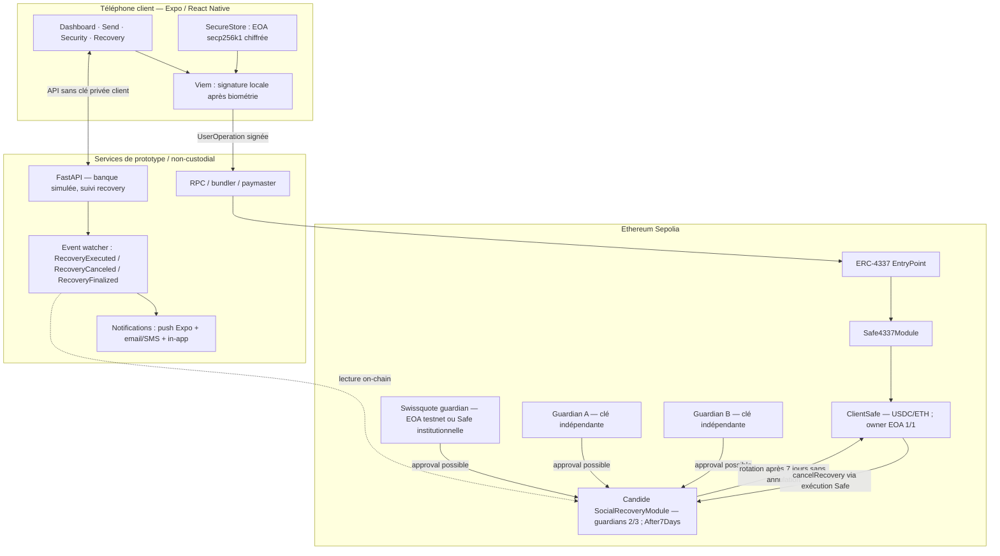
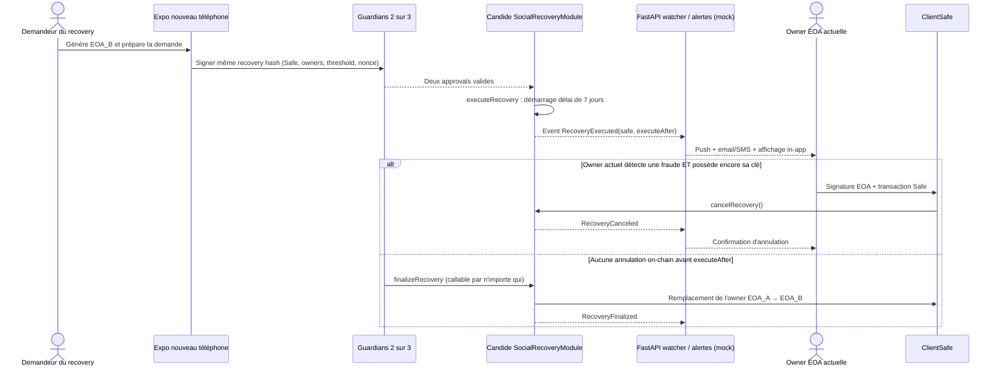

# Swissquote Self-Custody Wallet

> **BSA Hackathon — Swissquote Wallet Challenge**  
> **Statut :** architecture cible du prototype — audit de conformité au brief officiel EPFL/SQ du 10 octobre 2026 ; aucun code ni flux de récupération n’est présumé validé sur testnet.  
> **Plateformes :** iOS / Android · **Réseau cible :** Ethereum Sepolia (`chainId: 11155111`).  
> **Langues :** application et pitch potentiellement en anglais ; documentation technique en français.

## Sommaire

1. [Vision et périmètre](#1-vision-et-périmètre)
2. [Décisions d'architecture](#2-décisions-darchitecture)
3. [Architecture générale](#3-architecture-générale)
4. [Tech stack détaillée](#4-tech-stack-détaillée)
5. [Modèle de custody et gestion des clés](#5-modèle-de-custody-et-gestion-des-clés)
6. [Organisation des comptes Safe et des guardians](#6-organisation-des-comptes-safe-et-des-guardians)
7. [Recovery 2/3, alertes et annulation pendant 7 jours](#7-recovery-23-alertes-et-annulation-pendant-7-jours)
8. [Pertes, compromissions et rotation des guardians](#8-pertes-compromissions-et-rotation-des-guardians)
9. [Flux produit et blockchain](#9-flux-produit-et-blockchain)
10. [Backend et API](#10-backend-et-api)
11. [Sécurité, threat model et limites](#11-sécurité-threat-model-et-limites)
12. [UX et design mobile](#12-ux-et-design-mobile)
13. [Structure du monorepo](#13-structure-du-monorepo)
14. [Développement et configuration](#14-développement-et-configuration)
15. [Tests, critères d'acceptation et démonstration](#15-tests-critères-dacceptation-et-démonstration)
16. [Correspondance avec la track Swissquote](#16-correspondance-avec-la-track-swissquote)
17. [Plan de développement et répartition](#17-plan-de-développement-et-répartition)
18. [Risques techniques ouverts et plans de repli](#18-risques-techniques-ouverts-et-plans-de-repli)
19. [Références](#19-références)
20. [Checklist de conformité au brief officiel et AI disclosure](#20-checklist-de-conformité-au-brief-officiel-et-ai-disclosure)

---

## 1. Vision et périmètre

### Objectif

Créer une **wallet self-custodial intégrée à l'expérience Swissquote** : le client conserve le contrôle de ses actifs et de sa clé de signature, tout en profitant d'une application mobile simple et d'un **recovery assisté par Swissquote**.

La proposition de valeur est : **« Your keys. Your crypto. Swissquote by your side. »**

### Principes produit

- **Clé privée de dépense générée et conservée sur le téléphone du client**, jamais transmise au backend bancaire.
- **Safe Smart Account individuelle** : les cryptomonnaies du client résident à l'adresse de la Safe, pas à celle de l'EOA de signature.
- **Signature locale après confirmation transactionnelle et authentification Face ID / Touch ID / biométrie forte Android** (ou mode de secours explicitement choisi et testé) **à chaque demande de signature**. Le déverrouillage visuel de l’app seul est insuffisant.
- **Recovery assisté sans phrase de récupération pour le parcours courant** : remplacement de l’EOA owner par une nouvelle EOA avec module social recovery. **Continuité sans Swissquote :** les guardians A+B peuvent initier le recovery sans banque ; une sauvegarde hors appareil contrôlée par le client (par ex. phrase BIP-39 standard) fournit une voie supplémentaire de restauration de la même EOA.
- **Recovery 2-sur-3 classique : Swissquote est un guardian optionnel**, aux côtés de Guardian A et Guardian B. Deux approvals indépendantes suffisent, avec **7 jours de contestation on-chain** pendant lesquels l’owner actuel peut annuler. Le client peut ainsi récupérer via A+B sans Swissquote. Le Recovery Kit hors appareil reste une voie indépendante utile si les guardians ne répondent pas.
- **Gasless ERC-20** via ERC-4337 + paymaster lorsque le sponsoring est disponible.
- **Architecture bancaire crédible** : contrôle d'identité renforcé, suivi, traçabilité et compliance ; intégrations bancaires **simulées** pour le hackathon.
- **UX mobile premium** ; la complexité EOA/Safe/4337 reste cachée dans le parcours courant.

### Parcours de démonstration prioritaire

`Create → Protect + Backup → Fund → Face ID → Sign & Send → Lose Access → Recover (any 2/3) → 7-day challenge period → Finalize → Sign again`

**Scénario exigé par le brief (banque disparue) :** `Swissquote permanently unavailable → Guardian A + Guardian B recover the Safe on-chain → wait 7 days → new owner operates independently`. Alternative : restaurer l’EOA d’origine depuis un Recovery Kit hors ligne si encore valable. Démontrer une voie RPC/bundler indépendante et la disponibilité des fonds sans FastAPI Swissquote.

### Hors périmètre initial

Swaps, NFTs, multi-chain, navigateur dApps complet, infrastructure bancaire réelle, moteur AML/KYC certifié, audit de smart contracts, publication sur les stores.

### Avertissement

Il s'agit d'un **prototype sur testnet**, non d'une application bancaire ou d'un gestionnaire de clés prêt pour des fonds réels. Les modules existants doivent être revus, correctement configurés et testés. Aucun résultat juridique ou réglementaire n'est présumé acquis.

---

## 2. Décisions d'architecture

| Sujet | Décision | Statut |
|---|---|---|
| Distribution | Application mobile iOS/Android | **Retenu** |
| Framework | React Native + Expo (Development Build) | **Retenu** |
| Frontend | TypeScript, Expo Router, NativeWind, Reanimated | **Retenu** |
| Backend | Python + FastAPI | **Retenu** |
| Clé client | EOA Ethereum `secp256k1`, générée localement ; **option de génération via mnemonic BIP-39 + dérivation BIP-32/44 vérifiée pour un backup interopérable** | **Retenu ; workflow BIP-39 à valider** |
| Stockage | Expo SecureStore : Keychain iOS / Android Keystore-backed encrypted storage | **Retenu** |
| Validation des dépenses | Face ID / Touch ID / biométrie Android à chaque déverrouillage de la clé, avec `requireAuthentication` | **Exigence produit — tests sur vrai appareil** |
| Continuité hors Swissquote | **A+B** peuvent faire le recovery sans la banque ; Recovery Kit utilisateur indépendant en complément | **POC hors banque à réaliser** |
| Wallet qui reçoit les fonds | Safe Smart Account | **Retenu** |
| Owner ordinaire Safe client | EOA client, seuil `1/1` | **Retenu** |
| Recovery principal | **2 approvals sur 3 : Swissquote, Guardian A, Guardian B** | **Décidé** |
| Implémentation recovery | Candide Social Recovery Module, seuil `2/3` **à plat** | **POC on-chain** |
| Délai de rotation | **7 jours on-chain**, `After7Days` | **Décidé ; à tester** |
| Opposition du propriétaire | Transaction Safe signée par l’EOA actuelle → `cancelRecovery()` avant `executeAfter` | **Décidé ; à tester** |
| Alertes de recovery | Événements on-chain + push Expo + email/SMS + tableau de bord | **Prévu ; livraison non garantie par un seul canal** |
| Guardian Swissquote | EOA de test dans un service séparé ; Safe institutionnelle `2/3` facultative en production | **MVP simplifié / option institutionnelle** |
| Guardians personnels | Guardian A et Guardian B, **deux clés indépendantes**, idéalement hors téléphone principal | **Décidé** |
| Exécution | ERC-4337 / `UserOperation` | **Cible MVP** |
| SDK AA | `abstractionkit` (Candide) ; SDK Safe en repli | **Compatibilité Expo à valider** |
| Recovery SDK | Social Recovery Module Candide | **Compatibilité signatures EIP-1271 à valider** |
| Token démo | USDC de test ou ERC-20 explicitement identifié comme test | **Cible MVP** |
| Réseau | Sepolia | **Retenu** |
| Base de données | SQLite pour métadonnées de prototype | **Retenu** |

**Contrainte de custody :** deux guardians quelconques, y compris **Swissquote + A** ou **A + B**, peuvent collectivement proposer une nouvelle clé owner et, après 7 jours sans annulation, acquérir le contrôle de la Safe. Swissquote ne peut pas agir seule, mais une **collusion avec un autre guardian** demeure une zone grise juridique (custody partagée). Le délai donne à l’owner encore opérationnel une possibilité d’opposition, **pas un veto absolu**, puisqu’il peut avoir perdu sa clé.

---

## 3. Architecture générale



> **Garanties réelles vs fonctionnalités visées :** la période de 7 jours est imposée par le module on-chain sélectionné. Les alertes dépendent de services off-chain et **ne sont jamais garanties d'être reçues**. Leur absence n'arrête pas le délai.

> **Sortie sans Swissquote :** Guardian A et Guardian B peuvent satisfaire directement le seuil 2/3 sur le contrat, à condition d'accéder à une infrastructure blockchain indépendante. Une copie hors ligne de l'EOA encore owner constitue également une voie autonome distincte.

### Acteurs et pouvoirs

| Acteur | Pouvoir | Limite |
|---|---|---|
| **Client EOA** | Dépense normale et annulation de recovery via sa Safe | Ne peut pas annuler sans accès à la clé actuelle ; Face ID seul n'est pas une signature blockchain |
| **ClientSafe** | Détient les actifs et vérifie les autorisations | Modules à auditer/configurer correctement |
| **Swissquote guardian** | Peut donner **une** des deux approvals | Ne peut ni récupérer ni dépenser seul ; peut colluder avec A ou B |
| **Guardian A / Guardian B** | Une approval chacun | A+B peuvent récupérer sans banque ; chaque guardian isolé reste insuffisant |
| **Event watcher / notifications** | Détecte des changements et alerte | Ne bloque pas une rotation ; canal potentiellement indisponible/compromis |
| **Bundler / Paymaster** | Soumet et finance éventuellement les transactions | N'obtient jamais la clé EOA client |

### Deux adresses à distinguer

- **EOA du client** : signer autorisé et clé privée locale.
- **ClientSafe** : adresse de réception et de détention des USDC/ETH. La clé owner peut changer sans changer cette adresse.

## 4. Tech stack détaillée

### 4.1 Application mobile

| Package / technologie | Responsabilité | Notes |
|---|---|---|
| `expo`, `react-native` | Runtime mobile iOS / Android | Pas de SwiftUI à apprendre pour l'UI |
| `typescript` | Code de l'app et de la couche blockchain | Typage strict recommandé |
| `expo-router` | Navigation / deep links / onboarding / récupération | Parcours à étapes |
| `nativewind` | Styles, thèmes, design tokens | Composants réutilisables |
| `react-native-reanimated` | Micro-interactions et animations | Éviter les animations pendant l'approbation cryptographique |
| `expo-secure-store` | Secret EOA au repos + **déverrouillage biométrique au moment de signer** | `requireAuthentication: true`, `NSFaceIDUsageDescription` configuré ; **pas** de signature secp256k1 matérielle garantie, ni de garantie de confirmation cryptographique du montant par Face ID |
| `expo-crypto` | Entropie / octets aléatoires | Utiliser les API asynchrones / natives sûres ; **pas `Math.random`** |
| `expo-local-authentication` | Détection biométrique et, optionnellement, déverrouillage de l’interface | **Ne PAS se contenter** de `authenticateAsync()` pour autoriser la dépense ; l’accès au secret doit être protégé par `SecureStore.requireAuthentication`. API native et fallback à tester. |
| Expo Development Build | Tests sur appareils réels, plugins natifs | Privilégier au seul Expo Go |

### 4.2 Blockchain et smart accounts

| Technologie | Responsabilité | Notes |
|---|---|---|
| Ethereum Sepolia | Réseau de démonstration | `chainId: 11155111` |
| Ethereum EOA (`secp256k1`) | Clé privée/signature du client | Génération locale |
| `viem` | Signature EOA, comptes, encodage ERC-20, RPC | Vérifier sous Hermes/Metro ; `mnemonicToAccount`/HD seulement avec lib et chemins standard interopérables si backup BIP-39 adopté |
| **Safe Smart Account** | Détention des actifs ; owners ; modules | `ClientSafe` et, facultativement, `SwissquoteGuardianSafe` |
| **ERC-20** | Transferts de USDC de test | Vérifier contrat token + `decimals` |
| **ERC-4337** | UserOperations, EntryPoint, bundler | Requiert version Safe / module / EntryPoint compatible |
| **Safe4337Module** | Interface ERC-4337 du compte Safe | Safe v1.4.1+ suivant documentation officielle |
| `abstractionkit` | Construction de Safe/UserOperations, recovery | **Candidat prioritaire, non encore validé dans Expo** |
| Candide Social Recovery Module | Guardians, seuil, approbations, timelock, changement d'owner | Prend en charge un seuil standard 2/3 et une période de grâce After7Days |
| ERC-1271 | Uniquement si le guardian Swissquote est lui-même une Safe contractuelle | **Optionnel, non bloquant pour le MVP** |
| Bundler / paymaster compatibles | Inclusion on-chain et sponsoring gas | Fournisseur à choisir, quotas / clés API côté serveur |
| `@safe-global/protocol-kit` / Relay Kit | Solution alternative SDK | Ne pas mixer des versions incompatibles |

### 4.3 Backend et outils

| Technologie | Responsabilité |
|---|---|
| `python` + `fastapi` | APIs du compte Swissquote simulé, demandes de récupération, policies |
| `pydantic` | Validation stricte des payloads |
| `sqlite` + couche ORM légère (optionnelle) | Dossiers de recovery, metadata, journal ; **aucun secret EOA** |
| `eth-account` (ou signer Ethereum compatible) | Signature du guardian Swissquote **de test** en processus séparé, format à valider |
| `pytest` | Tests backend et de policies |
| Vitest / Jest | Tests TypeScript du module `wallet-core` |
| Git / GitHub | Versioning, PR, revue de code |
| RPC Sepolia + explorateur | Lecture des états et preuves des transactions |

**Convention :** fixer les versions exactes des packages et contrats dans le lockfile et `config/chains.ts`. Les noms de classes/SDK sont susceptibles de changer : conserver l'architecture, adapter l'API à la version retenue après POC.

---

## 5. Modèle de custody et gestion des clés

### 5.1 Clé normale du client

- **Type :** une clé privée EOA Ethereum `secp256k1`, 32 octets, valide dans le groupe secp256k1.
- **Création :** uniquement sur l’appareil, avec une source d’entropie cryptographiquement sûre. `expo-crypto.getRandomBytesAsync()` est préférable à toute API présentant un fallback non sécurisé en mode débogage. Utiliser une bibliothèque éprouvée pour valider la clé et dériver l’adresse. **Pour disposer d’une restauration autonome indépendante des guardians, envisager un parcours BIP-39/BIP-32/BIP-44 standard testé de bout en bout** : phrase de récupération générée via une bibliothèque reconnue avec entropie OS, EOA déterministe, restauration avec **le même chemin de dérivation**. Ne jamais inventer de conversion « phrase = clé ».
- **Stockage :** `expo-secure-store`, en utilisant les protections pertinentes sur chaque OS ; sur iOS, étudier `WHEN_PASSCODE_SET_THIS_DEVICE_ONLY` avec un fallback UX explicite lorsque le code appareil n'est pas configuré.
- **Accès :** `requireAuthentication: true` pour le secret dans SecureStore, et **nouveau `getItemAsync` après confirmation des détails à chaque tentative de signature**. La clé ne doit pas être conservée en mémoire entre deux transactions. S’il n’existe pas de biométrie/contrôle local assez fort, **refuser la signature jusqu’à la configuration d’une méthode de secours sûre et testée**, plutôt que simuler Face ID avec un simple état React. Le fallback code d’appareil, s’il est autorisé par l’OS, doit être explicite dans l’UX.
- **Signature :** clé déverrouillée temporairement dans l'application ; signature du hash de l'opération Safe selon les spécifications et SDK utilisés.
- **Interdictions :** pas de secret dans AsyncStorage, SQLite, Redux persistant, logs, crash reports, analytique, variables `EXPO_PUBLIC_*`, sources Git, backend ou requêtes réseau.
- **Limite explicite :** la clé EOA peut transiter dans la mémoire JavaScript au moment de signer. SecureStore protège essentiellement le secret **au repos**, pas contre un bundle/appareil compromis. La clé `secp256k1` n'est pas automatiquement une clé Secure Enclave non exportable.
- **Sauvegarde/continuité :** ajouter un **Recovery Kit hors ligne** contrôlé exclusivement par le client, créé pendant l’onboarding et testé par une restauration de l’EOA en environnement de démo. Le chemin le plus interopérable est une **phrase BIP-39** issue d’un compte HD dérivé avec un chemin explicite, sauvegardée **hors du téléphone et hors du compte Swissquote**, jamais uploadée sur une API ou synchronisée en cloud par notre app. Le workflow normal reste sans phrase ; ce kit sert exclusivement aux scénarios extrêmes, dont la disparition définitive de Swissquote. Une seed phrase exposée donne accès à la clé et constitue un risque de vol **majeur**. Si l’utilisateur refuse de sauvegarder le kit, expliquer que la récupération dépendra de la disponibilité d’au moins deux guardians ; Swissquote n’est pas requise si A et B restent disponibles.

### 5.2 Conditions de perte d'accès

- Changement de biométrie, suppression du code de verrouillage, désinstallation, restauration d'un backup ou changement de téléphone peuvent invalider ou faire disparaître la clé SecureStore.
- Tester iOS et Android avec ces scénarios ; les règles exactes diffèrent.
- Sur Android, **exclure les entrées SecureStore des backups automatiques** lorsqu'une configuration de backup personnalisée est utilisée : elles seraient indéchiffrables après une réinstallation.
- Aucune authentification biométrique seule ne garantit la pertinence du montant et du destinataire signés ; afficher les détails de l'opération et empêcher la signature de payloads opaques.

### 5.3 Emplacement des autres clés

| Clé / donnée | Emplacement | Contrôle |
|---|---|---|
| EOA client | Téléphone du client, SecureStore | Client seul |
| Adresse EOA, adresse Safe | Blockchain + métadonnées backend | Publique |
| Safes guardians et leurs owners | On-chain | Configurées indépendamment |
| Clé interne banque #1/#2/#3 | Environnements/systèmes distincts ; **clés de test pour MVP** | Swissquote (simulation) |
| Clé Guardian A | Appareil ou wallet indépendant | Guardian A |
| Clé Guardian B | Appareil ou wallet indépendant de A et de l'EOA principale | Guardian B |
| Identités, dossiers, alertes | FastAPI + SQLite | Services simulés |

**Production envisagée :** gestion institutionnelle des clés par HSM/KMS, procédures internes, journal d'audit, révocation, contrôle d'accès, et séparation entre décision de conformité et permission cryptographique. Ces protections ne sont **pas** fournies automatiquement par le prototype.

---

### 5.4 Validation des transactions par Face ID / biométrie native — exigence produit

L'expérience recherchée est : **revue détaillée → « Confirm with Face ID » → lecture biométrique du secret protégé → signature locale → broadcast**. Sur iOS avec Face ID l'OS présente son prompt ; sur les iPhone Touch ID et les Android compatibles, utiliser la biométrie native appropriée. L'application n'accède **jamais** aux empreintes ni aux données faciales.

**Conception de sécurité :**

1. Le client lit un récapitulatif du **payload réellement construit** : montant décodé, token, destination, Safe, réseau, frais, résultat de simulation et risque.
2. Après confirmation explicite, appeler `SecureStore.getItemAsync` avec **`requireAuthentication: true`** afin de déverrouiller la clé EOA. Cette lecture doit être liée dans notre code à **cette** demande de signature, pas à l'authentification générale de session.
3. Si l'OS refuse, si l'utilisateur annule, si le téléphone n'a pas de verrouillage adapté ou si la clé est invalidée : **pas de signature**. Prévoir configuration de biométrie, fallback de code appareil uniquement si la politique et le comportement du système le permettent, ou recovery.
4. Après authentification, **reconstruire/vérifier le digest et les paramètres** ; signer le hash Safe/ERC-4337 avec viem ; ne pas laisser la clé en state global, cache, logs, captures ni appels backend. Un nouveau transfert doit exiger une **nouvelle lecture protégée**.
5. Suspendre/annuler le flux à la mise en arrière-plan, à un changement de payload ou à un changement de réseau. Ne jamais interpréter une authentification réussie pour une opération comme autorisant une autre opération.

**Nuance :** Face ID ne signe **pas directement** la transaction Ethereum ; il déverrouille l'accès au secret chiffré. Nous exigeons une nouvelle lecture protégée pour chaque opération, mais la **fréquence et la présentation exacte des prompts** dépendent des politiques de cache/authentification d’iOS/Android et doivent être confirmées sur appareils réels ; ne pas promettre un prompt matériel cryptographiquement lié au montant. Le secret est ensuite utilisé par le JavaScript pour signer. `expo-local-authentication.authenticateAsync()` seul ne sécurise pas la clé : sans `requireAuthentication` côté SecureStore, un code compromis pourrait contourner la modale UI. Même avec ce réglage, un code compromis après authentification peut abuser du secret en mémoire ; le contrôle on-chain du détail de transaction demanderait un signer isolé ou des règles contractuelles additionnelles.

#### Config Expo (illustrative, à adapter à la version SDK installée)

```json
{
  "expo": {
    "plugins": [
      [
        "expo-secure-store",
        {
          "configureAndroidBackup": true,
          "faceIDPermission": "Autoriser Swissquote Wallet à utiliser Face ID pour confirmer les transactions."
        }
      ]
    ],
    "ios": {
      "infoPlist": {
        "NSFaceIDUsageDescription": "Utiliser Face ID pour autoriser l'accès à la clé de signature des transactions."
      }
    }
  }
}
```

```ts
import * as SecureStore from 'expo-secure-store';

const KEY_ID = 'wallet.owner.privateKey.v1';
const secureAccess = {
  requireAuthentication: true,
  authenticationPrompt: 'Confirmer la signature de cette transaction',
  keychainAccessible: SecureStore.WHEN_PASSCODE_SET_THIS_DEVICE_ONLY,
} as const;

// Après création de la clé sur le téléphone :
await SecureStore.setItemAsync(KEY_ID, ownerPrivateKey, secureAccess);

// DANS LE FLUX DE SIGNATURE, après preview/validation du payload :
const unlockedKey = await SecureStore.getItemAsync(KEY_ID, secureAccess);
if (!unlockedKey) throw new Error('Signature refusée : clé inaccessible ou auth annulée');
// Passer unlockedKey immédiatement au signer local ; ne jamais le mettre dans un store global.
// Ce snippet est illustratif : vérifier les comportements iOS/Android en Development Build.
```

- **Testing :** vrai iPhone avec Face ID, vrai Android biométrique, annulation, lockout, changement d'empreinte/visage, code appareil, app background, tentative de deuxième signature sans nouvel accès au secret. **Face ID ne fonctionne pas dans Expo Go** pour `expo-local-authentication` et la protection biométrique de SecureStore nécessite la configuration native.
- Si vous ajoutez `expo-local-authentication` pour déverrouiller l'UI, configurer **la même explication Face ID** ; éviter les deux prompts consécutifs inutiles. La vérification qui protège le secret reste celle de SecureStore.
- **Opérations sensibles élevées :** afficher un avertissement et une confirmation supplémentaire pour les montants > seuil de démonstration (ex. 1 000 USDC test), éventuellement une revue bancaire simulée avant sponsoring. **Cela ne constitue pas un blocage on-chain** : l'imposer à toutes les voies d'exécution exigerait un Safe guard/module audité et une revue de ses pouvoirs.


## 6. Organisation des comptes Safe et des guardians

### 6.1 `ClientSafe` — wallet qui détient les fonds

```yaml
ClientSafe:
  network: Ethereum Sepolia
  assets: [ETH, USDC_test]
  owners: [ClientEOA]
  owner_threshold: 1
  recovery_module: Candide SocialRecoveryModule # After7Days
  recovery_guardians:
    - SwissquoteGuardianAddress
    - GuardianAAddress
    - GuardianBAddress
  guardian_threshold: 2 # 2 / 3, A+B valides sans Swissquote
```

Les guardians ne sont **pas** des owners normaux : ils n'autorisent pas les paiements ordinaires. Le module de recovery peut néanmoins remplacer les owners lorsque les règles et délais du protocole sont satisfaits ; c'est un pouvoir sensible sur les fonds.

### 6.2 Les trois guardians directs (seuil à plat)

| Guardian | Stockage de la clé | Rôle / isolation |
|---|---|---|
| **Swissquote** | **MVP :** EOA de test détenue par un processus signer backend séparé de FastAPI ; **production :** signer institutionnel HSM ou Safe multisig interne | Vérification d'identité simulée et approbation facultative |
| **Guardian A** | Wallet ou appareil indépendant de l'EOA principale, **non contrôlé par Swissquote** | Approbation personnelle indépendante |
| **Guardian B** | Deuxième wallet / hardware wallet / personne indépendante | Approbation alternative, notamment si Swissquote disparaît |

**Pas de `BackupGuardianSafe` nécessaire.** Les trois adresses sont enregistrées directement sur `ClientSafe` via le module Candide. `SwissquoteGuardianSafe` interne `2/3` est une **évolution facultative**, distincte du seuil externe de recovery `2/3`, pas une dépendance du MVP. Cela évite l'ancien POC bloquant des signatures ERC-1271 imbriquées.

### 6.3 Matrice d'approbation

| Approbations | Seuil atteint ? | Rotation immédiate ? |
|---|---|---|
| Swissquote + A | ✅ | ❌ 7 jours de contestation |
| Swissquote + B | ✅ | ❌ 7 jours de contestation |
| A + B, **sans Swissquote** | ✅ | ❌ 7 jours de contestation |
| Swissquote seule / A seul / B seul | ❌ | ❌ |
| Swissquote + A + B | ✅ | ❌ 7 jours de contestation |

### 6.4 Choix du module et délai

Candide expose un sélecteur de période **préconfigurée**. Choisir explicitement le module déployé à sept jours, et vérifier son adresse et sa période effective sur Sepolia :

```typescript
import {
  SocialRecoveryModule,
  SocialRecoveryModuleGracePeriodSelector,
} from 'abstractionkit';

const recovery = new SocialRecoveryModule(
  SocialRecoveryModuleGracePeriodSelector.After7Days
);
// Important : utiliser cette instance pour configurer ET interroger le module.
// Ne pas supposer que le délai par défaut (3 jours) est de 7 jours.
```

La durée n'est **pas** un `setTimeout()` JavaScript ou un compteur dans FastAPI : le smart contract stocke `executeAfter = block.timestamp + recoveryPeriod` et `finalizeRecovery()` interdit la finalisation anticipée. Les signatures des guardians ne changent jamais directement l'owner.

---

## 7. Recovery 2/3, alertes et annulation pendant 7 jours

### 7.1 Déroulement normal



1. Un appareil neuf génère localement `EOA_B` et crée une demande de recovery, contenant Safe, nouveaux owners, nouveau seuil, chain et nonce dans le **format réel de Candide**.
2. **Deux guardians quelconques** signent exactement la même demande : `SQ+A`, `SQ+B` ou `A+B`.
3. L'appel `executeRecovery(...)` / `multiConfirmRecovery(..., execute=true)` est inclus sur blockchain : événement **`RecoveryExecuted`**, `executeAfter` enregistré. **C'est le début des 7 jours** (pas la première approval hors chaîne).
4. Le watcher observe et confirme l'événement ; alertes multi-canaux, suivi visible dans l'application et sur l'explorateur. Montrer la **nouvelle adresse owner**, les guardians ayant autorisé et une date butoir lue depuis la chaîne.
5. Jusqu'à `executeAfter`, **l'owner actuellement autorisé** peut faire appeler `cancelRecovery()` par `ClientSafe` : il signe une opération normale avec son EOA et son déverrouillage Face ID/biométrique ; les frais doivent être pris en charge par un paymaster ou un parcours de paiement indépendant.
6. Une fois la transaction d'annulation confirmée, le module supprime la demande et émet **`RecoveryCanceled`**. Le tableau de bord passe à *Canceled*. Si l'annulation n'est pas confirmée à temps, **aucune promesse de réussite**.
7. Si le délai s'achève sans annulation, un acteur déclenche **`finalizeRecovery(ClientSafe)`** (public). La Safe autorise désormais `EOA_B`, l'ancienne EOA perd ses droits, et **l'adresse de la Safe / les fonds restent inchangés** si aucun autre transfert n'a eu lieu.

**Important :** le système garantit **une fenêtre temporelle de contestation sur chaîne**, pas une notification effectivement reçue pendant cette fenêtre. Un service de notification en panne ne retarde pas la finalisation.

### 7.2 Comment implémenter le bouton « Cancel recovery »

**Concept de transaction Safe** (pseudo-code d'intégration, volontairement indépendant des noms de méthodes d'un SDK donné) :

```typescript
// Sur ClientSafe, préparer une opération ordinaire :
import { encodeFunctionData, parseAbi } from 'viem';

const metaTx = {
  to: SOCIAL_RECOVERY_MODULE_7D_ADDRESS,
  value: 0n,
  data: encodeFunctionData({
    abi: parseAbi(['function cancelRecovery()']),
    functionName: 'cancelRecovery',
  }),
};
// 1. Reconstruire/vérifier chainId, Safe, module activé, calldata.
// 2. Exiger confirmation et déverrouiller l'EOA via SecureStore (biométrie).
// 3. Signer localement la UserOperation Safe.
// 4. Soumettre via bundler/paymaster ou une voie alternative.
// 5. Ne déclarer « annulé » qu'après confirmation on-chain de RecoveryCanceled.
```

**Pourquoi passer par la Safe ?** Dans le contrat vérifié, `cancelRecovery()` agit sur `msg.sender`, qui doit être la **Safe** disposant de la demande. Un simple `fetch('/cancel')`, un email, Face ID seul ou une transaction **directe de l'EOA vers le module** ne constitue pas l'annulation cryptographique attendue.

**Avant l'exécution on-chain du recovery :** des approvals peuvent déjà avoir été collectées hors chaîne. Prévoir des alertes dès création/approbation côté service et vérifier la stratégie d'invalidation du nonce via l'appel Safe `invalidateNonce()` lorsque pertinent (API/phase exacte à tester). Ce n'est pas identique à `cancelRecovery()` sur une demande déjà en période de grâce.

### 7.3 Notifications : plusieurs canaux, deux sources d'information

**Source de vérité = événements et état de contrat, pas FastAPI.**

- **On-chain watcher** (FastAPI worker ou service séparé) : surveille `RecoveryExecuted`, `RecoveryCanceled`, `RecoveryFinalized` pour chaque Safe suivie, déduplique les événements, attend les confirmations appropriées et redémarre en rebalayant les blocs manqués. Lit `executeAfter` sur chaîne.
- **Push Expo** : alerte sur le téléphone enregistré (« Security alert: wallet recovery requested »), avec liens profonds vers l'écran Security. Une push n'est pas garantie, notamment si le téléphone est perdu/désactivé.
- **Email + SMS** (adresses/n° préenregistrés et vérifiés, au moins un canal indépendant du téléphone principal) : message avec Safe, nouvelle EOA abrégée, échéance, et instruction de vérification. Pas de lien ouvrant une signature opaque.
- **In-app** : bannière prioritaire, historique d'alertes et compte à rebours calculé depuis **`executeAfter`** on-chain, pas une valeur renvoyée librement par un serveur.
- **Service Candide Recovery UX API** (option) : fonctionnalités de souscription email/SMS signée par l'owner via SIWE, statut et alertes. **Nécessite un accès au service et son support effectif pour le réseau**, donc prévoir un watcher autonome si indisponible.
- **Journaux/audit** : enregistrer en base les événements, tentatives d'alertes, éventuels retours d'envoi, et confirmations d'annulation. Un accusé de réception d'une push **ne prouve pas** que le client a vu le message.

**Politique d'alerte proposée (produit, pas propriété du contrat) :** alerter dès la première demande côté backend et au début de la période on-chain ; relancer durant les 7 jours si non annulé ; signaler les dernières 24 heures ; notifier toute annulation ou finalisation. **Aucun canal ne doit être l'unique protection.**

### 7.4 Cas où le client a réellement perdu sa clé

L'owner **ne peut pas annuler** sans une signature valide de l'EOA encore autorisée : la récupération est précisément faite pour ces situations. Une copie BIP-39 de **la même EOA encore owner** permet de restaurer sa capacité d'annulation sur un autre appareil. **Une nouvelle EOA non encore owner ne peut pas annuler** pendant le délai.

Le risque résiduel demeure : **deux guardians collusifs** peuvent faire une récupération frauduleuse si le client ne voit pas les alertes ou ne possède plus sa clé. En revanche, si un attaquant possède la clé EOA originale, il peut **annuler une récupération légitime** ou dépenser avant sa révocation ; le délai de recovery n'est pas un gel de dépenses.

Après une tentative malveillante annulée, révoquer/remplacer rapidement les guardians compromis et invalid(er) les approvals encore utilisables, conformément aux capacités de la version du module. Prévoir un cas d'urgence et des contrôles additionnels pour les montants élevés.

### 7.5 Démo hackathon vs paramètre cible

- **Architecture cible :** `After7Days`, testé on-chain, et capture de `executeAfter` réelle.
- **Démo accélérée sur Safe de test distincte :** sélecteur `After3Minutes` uniquement si nécessaire pour montrer **create → sign → recover** dans la durée de l'événement. La démo doit afficher clairement « Demo period: 3 minutes » et expliquer qu'un déploiement à 7 jours utilise **un module/adresse différente**, pas un timeout local.
- **Tester impérativement l'annulation** sur une Safe avec `After7Days` sur Sepolia (pas besoin d'attendre 7 jours pour prouver la cancellation). Tester séparément la finalisation avec `After3Minutes`.

---

## 8. Pertes, compromissions et rotation des guardians

### 8.1 Disponibilité avec seuil 2/3

| Incident | Recovery | Action |
|---|---|---|
| Guardian A perd sa clé | ✅ Swissquote + B, si disponibles | Remplacer A depuis owner valide |
| Guardian B perd sa clé | ✅ Swissquote + A, si disponibles | Remplacer B |
| Swissquote indisponible / disparaît définitivement | ✅ **A + B**, sans la banque | Utiliser une interface indépendante, RPC et service d'exécution disponible |
| Swissquote perd sa clé de test | ✅ A + B, si disponibles | Remplacer Swissquote quand l'EOA cliente reste accessible |
| Un des guardians personnels perdu et Swissquote disparue | ❌ si plus que **un** guardian sur trois peut signer | Backup de l'EOA owner ou mise à jour préventive des guardians |
| Deux guardians perdus et EOA client encore valide | Le client conserve les dépenses normales, mais ne peut plus compter sur recovery | Remplacer les guardians tant que l'owner fonctionne |
| Deux guardians perdus ET EOA client perdue | ❌ Par recovery | Un Recovery Kit de l’EOA encore owner peut aider s'il existe |
| EOA client perdue, deux guardians disponibles | ✅ après 7 jours + finalisation | Nouvelle EOA puis rotation |
| EOA compromise / attaquant possède la clé | Recovery ne gèle pas les dépenses ni ne garantit la révocation | Procédure d'urgence et protections on-chain spécifiques si prévues |

### 8.2 Maintenance des guardians

- **Owner actuel avec sa clé :** peut remplacer directement un guardian via la procédure sécurisée de mise à jour de la configuration Candide, après Face ID/biométrie + transaction Safe. Mettre à jour le journal et renouveler les alertes. Vérifier si `invalidateNonce()` est pertinent pour rendre caduques des approvals anciennes.
- **Owner perdu, mais 2 guardians encore actifs :** déclencher recovery standard, respecter le délai et remplacer les guardians hors service **après** rotation.
- **Clés compromises :** éviter le stockage partagé des clés guardians, révoquer rapidement toute clé exposée, annoncer les changements à l'utilisateur.
- **Swissquote en production :** option d'une Safe institutionnelle `2/3` avec 3 signers réellement indépendants, sans modifier le seuil externe de `ClientSafe` ; cette variante nécessite des tests ERC-1271 spécifiques mais ne bloque plus le prototype.

### 8.3 Menaces spécifiques au délai de sept jours

- **Notification manquée ou supprimée** : délai court quand même ; prévoir canaux multiples et surveillance RPC indépendante.
- **Backend Swissquote hors service** : ni les guardians A+B ni l'annulation via une interface blockchain indépendante ne doivent dépendre de FastAPI.
- **Attaquant avec EOA actuelle** : peut vider le compte ou interrompre un recovery légitime ; 7 jours **ne protègent pas** contre cette compromission.
- **Annulation non incluse à temps** : confirmer la transaction on-chain avant échéance ; UX doit afficher les échecs et délais de soumission, sans résultat fictif.
- **Deux guardians collusifs** : peuvent remplacer l'owner après délai si l'owner ne peut pas annuler ; c'est le compromis du modèle 2/3.

---

## 9. Flux produit et blockchain

### 9.1 Onboarding — `Create + Protect`

1. L’utilisateur accède au compte Swissquote **simulé** via le token de démonstration ; `GET /auth/me` fournit le statut KYC configuré côté serveur. Seul `verified` permet l’onboarding bancaire. Les états `pending`/`rejected` sont visibles ; aucune pièce d’identité réelle n’est collectée.
2. Expo génère une EOA locale et la protège dans SecureStore. **Pour le parcours de sortie indépendante, utiliser une génération BIP-39/BIP-32/BIP-44 standard** et faire enregistrer la phrase de restauration hors appareil, en vérifiant la même adresse dérivée. Ne pas activer les dépôts avant l’écran de risque lié à cette sauvegarde.
3. L'application prépare/déploie `ClientSafe` avec `owner = ClientEOA`, `threshold = 1`.
4. Configurer le module ERC-4337 compatible et le module de recovery sans collisions de handlers / versions.
5. Enregistrer **trois guardians directs** sur le module Candide : Swissquote, Guardian A et Guardian B, seuil `2/3`, avec instance `After7Days`. Vérifier l’adresse du module sélectionné.
6. Vérifier on-chain les owners, seuils, modules et guardians.
7. Afficher la **ClientSafe address** pour recevoir les actifs.

**Invariant d'onboarding :** ne pas encourager un dépôt tant que `ClientSafe` et la configuration de sécurité annoncée ne sont pas effectivement vérifiées. Certaines Safes peuvent avoir une adresse prédite avant leur déploiement : indiquer cet état explicitement.

### 9.2 `Receive`

- Montrer **uniquement l'adresse `ClientSafe`** comme adresse de réception normale.
- Permettre la copie/QR code et indiquer clairement le réseau Sepolia.
- Lire les soldes d'ETH et ERC-20 via RPC (ou indexeur, si nécessaire).

### 9.3 `Sign & Send` — USDC de test

1. Saisie du destinataire et du montant.
2. Vérifications : adresse, réseau, contrat token autorisé, décimales, solde, simulation, politique de risque.
3. Encodage de l'appel `ERC20.transfer(recipient, rawAmount)` pour qu'il soit **émis par `ClientSafe`**.
4. Construction de la `UserOperation` avec nonce, frais et éléments exigés par les SDK/protocoles choisis.
5. **Affichage de confirmation détaillé** : actif, quantité, adresse destinataire, réseau, coût/sponsoring ; action explicite « Confirm with Face ID / biométrie » après revue.
6. **À chaque transfert :** `SecureStore.getItemAsync` avec `requireAuthentication:true`, prompt natif Face ID/Touch ID/biométrie Android (fallback OS explicite selon l’appareil). Si annulation/échec : **aucune signature**. Puis **signature sur appareil**, jamais à partir d’une clé précédemment gardée en mémoire.
7. Envoi de la UserOperation signée au bundler ; paymaster éventuel pour payer le gas.
8. Validation EntryPoint / Safe4337Module, exécution depuis ClientSafe ; transaction visible sur Sepolia.
9. Lecture du reçu, affichage de `userOpHash` et du hash de transaction, actualisation du solde.

**Ce que l'application signe :** une autorisation Safe / ERC-4337 correctement encodée avec les nonces, domain separation et chain context attendus. **Ne jamais signer aveuglément un hash fourni par FastAPI** : l'app doit reconstruire ou vérifier localement les données critiques avant signature.

### 9.4 `Gasless`

- **ERC-4337 n'est pas le paymaster** : le bundler soumet l'opération, et un paymaster compatible peut en financer le gas.
- Si le sponsoring est refusé/indisponible, informer l'utilisateur et ne jamais annoncer une transaction gasless réussie.
- Quotas et autorisations de sponsoring se gèrent côté serveur/fournisseur : les clés API privilégiées ne vont **pas** dans `EXPO_PUBLIC_*`.
- Le gas reste payé sur la blockchain, mais pas directement par l'utilisateur lorsque sponsorisé.

### 9.5 `Compliant interaction` — bonus

- Screening d’adresses simulé (`allowed`, `review`, `blocked`) avant la signature ; les vérifications AML/sanctions réelles et les données de Travel Rule ne sont pas disponibles dans ce MVP.
- Simulation de transaction et validation du contrat destination.
- Liste restreinte de dApps ou contrats approuvés pour la démo ; pas de navigateur complet.
- **Précision :** bloquer l'UI ou le sponsoring n'empêche pas nécessairement une transaction signée d'être propagée autrement. Une interdiction effective on-chain demanderait une politique/guard/module sur la Safe, à analyser avec prudence.

---

## 10. Backend et API

### 10.1 Services FastAPI

| Domaine | Rôle | Secret client ? |
|---|---|---|
| `auth` | Comptes bancaires et sessions **simulés** | **Non** |
| `wallet_registry` | Mapping client fictif → ClientSafe / owner public | **Non** |
| `recovery` | Dossiers, statuts, coordination et alertes | **Non** |
| `guardian_policy` | Contrôles préalables à l'approbation Swissquote | Clés bancaires **de test**, isolées du flux API |
| `compliance` | Résultats de screening **simulés** | **Non** |
| `transactions` | Suivi RPC, réception des hashes et affichage | **Non** |
| `sponsorship` | Politique de gas sponsorisé, quotas, jetons serveur | Secrets prestataire uniquement côté serveur |

### 10.2 Endpoints proposés (contrats d'API, non implémentés)

```text
GET    /health
POST   /auth/mock-login
GET    /wallets/me
POST   /wallets/register                 # associer une Safe contrôlée au client fictif
GET    /wallets/{safeAddress}/activity
POST   /transactions/screen              # simulation/contrôle de destination
POST   /sponsorship/authorize            # policy, pas signature client
POST   /recovery/requests
GET    /recovery/requests/{requestId}
POST   /recovery/requests/{requestId}/identity-review
POST   /recovery/requests/{requestId}/swissquote-approve  # optionnel : SQ guardian
GET    /recovery/requests/{requestId}/status
GET    /wallets/{safeAddress}/recovery-status          # chaîne = autorité
POST   /alerts/register                                # push/email/SMS vérifiés
POST   /alerts/test                                    # notification de test
```

Les endpoints ne doivent accepter **aucune clé privée client**. Les données fournies par le client doivent être validées sur le réseau et contre l'état on-chain. Une session bancaire seule n'autorise pas `swissquote-approve` : appliquer le contrôle d'identité et la policy institutionnelle du prototype.

### 10.3 Modèle de données minimal

```text
MockUser(id, display_name, status)
WalletRegistration(id, user_id, chain_id, client_safe_address, owner_address)
GuardianConfiguration(wallet_id, guardian_swissquote, guardian_a, guardian_b,
                      guardian_threshold, recovery_module_address, grace_period_seconds)
RecoveryCase(id, wallet_id, new_owner_address, status, created_at,
             onchain_recovery_nonce, execute_after, canceled_tx_hash, finalized_tx_hash)
RecoveryAlert(id, recovery_case_id, channel, destination_hint, status, sent_at)
TransactionRecord(id, wallet_id, userop_hash, tx_hash, token_address,
                  recipient, amount_base_units, status)
AuditEvent(id, case_id, actor, action, timestamp, metadata)
```

**Source de vérité :** `owners`, `thresholds`, `modules`, soldes et statuts définitifs de transaction sont **on-chain**. SQLite n'est qu'un cache/registre applicatif.

### 10.4 Frontières de confiance

- **Signer guardian Swissquote (mock isolé)** : une EOA **testnet** dédiée, stockée dans un processus distinct de FastAPI avec son propre stockage. Ce signer produit **une seule** approval, optionnelle, jamais une dépense client. Les guardians A et B gardent chacun leurs clés indépendantes. Une institutionnelle `SwissquoteGuardianSafe` avec signers séparés peut être introduite ultérieurement. Le brief impose une isolation spécifique des *mocked share holders MPC* ; nous n’utilisons pas de MPC, mais séparons malgré tout les secrets pour limiter les risques.
- **Expo** : détient et utilise la clé EOA utilisateur ; vérifie localement les opérations signées.
- **FastAPI** : orchestre les workflows et décisions de la banque simulée ; ne possède aucun secret de dépense du client.
- **Guardian Swissquote** : peut participer au recovery selon les règles on-chain ; la permission est différente de celle de l'owner client.
- **Bundler / paymaster / RPC** : services externes ; ne doivent pas être considérés comme des sources fiables pour les intentions de transaction.

---

## 11. Sécurité, threat model et limites

### 11.1 Actifs à protéger

1. Clé privée `ClientEOA` et intégrité du processus de signature.
2. Configuration de `ClientSafe` : owners, seuil, modules, fallback handlers, politiques.
3. Clés et autorisations des guardians institutionnel et secondaires.
4. Intégrité des demandes de recovery et des paramètres approuvés.
5. Identité du bénéficiaire et montant d'une transaction.
6. Disponibilité du système de récupération.

### 11.2 Menaces et contrôles

| Menace | Impact | Mesures prévues | Limite résiduelle |
|---|---|---|---|
| Vol d'un téléphone verrouillé | Tentative d'accès à la clé | SecureStore + verrouillage système | Protection varie selon OS/configuration |
| Téléphone déverrouillé / malware / JS compromis | Signature frauduleuse, potentielle exposition du secret | UI explicite, revue des dépendances, build contrôlé, authentification | SecureStore n'isole pas totalement le secret en mémoire |
| Perte complète de `ClientEOA` | Lockout | Recovery 2/3 sans dépendance obligatoire à Swissquote | Échec si moins de 2 guardians actifs |
| Compromission email ou session bancaire | Recovery frauduleux | Vérification d'identité supplémentaire, second guardian indépendant | KYC mock n'est pas une garantie réelle |
| Collusion de deux guardians (SQ+A, SQ+B **ou A+B**) | Remplacement frauduleux de l’owner après 7 jours | Timelock on-chain, alertes multi-canaux, bouton d’annulation signé | Si clé owner perdue/compromise ou alertes non reçues, recovery peut aboutir |
| Swissquote indisponible / définitivement disparue | Le guardian Swissquote ne signe plus | Guardian A + Guardian B récupèrent sans banque ; sinon Recovery Kit EOA | Si A/B ou kit inaccessible, l’owner peut rester bloqué |
| Bug / module Safe dangereux | Dépenses non autorisées ou blocage | Contrats réputés, revue des permissions, version pinning, tests | Absence d'audit projet |
| Payload backend/RPC malveillant | Signature du mauvais montant/contrat | Décodage et vérification locale ; allowlists | UX doit empêcher les signatures opaques |
| Rejeu de signature | Opérations répétées | Nonces et domaines cryptographiques imposés par SDK/contrats | Dépend des versions installées |
| Phishing guardian | Validation d'un faux recovery | Afficher la Safe, nouvelle adresse, contexte ; vérification indépendante | Une mauvaise UX peut faire approuver l'attaque |
| Dépendance bundler/paymaster | Transaction non soumise | Erreurs explicites + fournisseur de repli éventuel | Pas de promesse de disponibilité |

### 11.3 Règles impératives

- Ne pas écrire de cryptographie maison (ECDSA, MPC, chiffrement ou sérialisation cryptographique ad hoc).
- Pas de clés réelles dans Git, images de démo, captures, analytics, erreurs ou variables publiques Expo.
- Aucun signer maître / owner caché contrôlé par l'équipe de dev ou Swissquote sur `ClientSafe`.
- Les modules Safe sont privilégiés : vérifier **exactement** leurs pouvoirs et adresses.
- La présence d'un guardian Swissquote n'est pas une preuve de conformité légale.
- Les signatures EIP-1271 des Safes guardians doivent correspondre au **recovery hash exact** et à la configuration de validation de chaque Safe.
- Traiter un *guardian perdu* et un *guardian compromis* différemment : en cas de compromission, agir immédiatement.
- Distinguer **sécurité réelle** et **contrôles KYC/compliance mockés**.

### 11.4 Limitations du modèle

- **Pas de veto bancaire :** si Swissquote refuse ou disparaît, A+B peuvent valider le recovery. Une seule clé guardian perdue n’empêche pas la récupération, mais deux clés guardian indisponibles l’empêchent.
- **Absence de garantie de restitution des fonds :** un owner EOA compromis peut vider `ClientSafe` avant le recovery.
- **Risque de collusion :** n’importe quels deux guardians parmi SQ, A et B peuvent initier la rotation. La période de sept jours est contestable seulement si le propriétaire dispose toujours d’une signature owner valide.
- **Governance :** le propriétaire peut modifier les guardians selon les permissions du module ; Swissquote n’est ni obligatoire ni immuable. La politique de notification des changements de guardian doit être testée.
- **Sécurité du code mobile :** des mises à jour malveillantes ou un appareil compromis peuvent attaquer le flux de signature ; les sauvegardes et la biométrie ne constituent pas une preuve de sécurité parfaite.
- **Legal :** la qualification self-custodial/non-custodial et les responsabilités suisses dépendent des droits effectivement accordés et d'une analyse juridique ; aucune homologation n'est revendiquée.

---

### 11.5 Custody partagée : avis juridique nécessaire (document officiel)

La track demande explicitement de répondre à **« could Swissquote, alone or together with a partner, move the funds without the client? »**. La réponse défendable pour **notre configuration** est :

| Participant | Capacité sans la clé EOA cliente | Conséquence |
|---|---|---|
| Swissquote seule | Ne peut pas satisfaire le recovery 2/3, ni exécuter une dépense normale | Pas de contrôle unilatéral |
| Guardian A seul / B seul | Ne peut pas satisfaire le recovery 2/3 | Pas de contrôle unilatéral |
| Swissquote + A **ou** B | Peut proposer un nouvel owner ; après 7 jours sans cancellation on-chain, finalisation autorisée | **Pouvoir collectif indirect sur les fonds** |
| **Guardian A + Guardian B, sans Swissquote** | Peut également proposer un nouvel owner après 7 jours ; pas de dépendance à la banque | Résilience accrue mais **collusion personnelle possible** |
| Client via EOA valide / restauration de son Recovery Kit | Autorise les dépenses normales ou la gestion de la Safe sans Swissquote | Autonomie opérationnelle tant que la clé utilisateur demeure accessible |

Le **legal primer officiel** décrit cette situation de contrôle partagé banque + tiers comme **zone grise**, pas comme une validation automatique du modèle « non-custodial ». Il faut qualifier la wallet de **client-controlled smart account with assisted shared-power recovery**, et **non** de produit juridiquement attesté *non-custodial*. Il faudrait notamment examiner les règles bancaires/AML, les droits réels des modules, la gouvernance et les conditions de responsabilité/insolvabilité pour une offre réelle. FINMA Guidance 01/2026 traite des responsabilités et risques de la custody de cryptoactifs, mais **ne valide pas individuellement notre système**.

**Décision produit assumée :** Swissquote **n’a aucun droit de veto** sur la récupération par guardians. A+B permettent une récupération sans banque, et le Recovery Kit demeure une sauvegarde supplémentaire. Toutefois la banque **avec un tiers**, ou les **deux guardians personnels**, peuvent obtenir le contrôle après un délai de 7 jours si l’owner n’annule pas. Cela nécessite une analyse juridique du pouvoir partagé ; le délai n’équivaut pas à une approbation explicite du client.

### 11.6 Travel Rule et vérification de la wallet — intégration prototype

**Ce qui est demandé par le brief :** démontrer la propriété/maîtrise d'une wallet self-hosted au moment des transferts Swissquote et préciser quand Swissquote est ou non institution émettrice. Le guide simplifie les obligations ; l'application réelle dépend du rôle des parties, du type de transfert et des règles en vigueur.

**Flux banque → `ClientSafe` (sortie depuis le compte Swissquote) :**

1. Le client s'authentifie à son **compte bancaire Swissquote simulé** (preuve d'identité/KYC côté banque, distincte de Face ID local).
2. FastAPI génère un challenge à **nonce unique**, durée limitée, domaine et chain ID, lié à `client_id`, `ClientSafe`, action de liaison et moment de création.
3. Le client confirme le challenge et le **signe avec l’EOA owner** sur son téléphone après authentification locale ; le backend vérifie la signature, consulte `ClientSafe.getOwners()` / configuration de contrôle on-chain et enregistre une **preuve datée de contrôle** liée à l'identité bancaire. Pour un schéma contractuel plus complexe, vérifier la signature avec la règle de validation du smart account (par ex. ERC-1271) plutôt que supposer un owner unique.
4. Avant tout transfert réel, la banque appliquerait ses contrôles AML/Travel Rule, identification du bénéficiaire et des contreparties pertinentes. **MVP : vérification de contrôle réelle sur testnet si développée ; KYC/Travel Rule provider et transfert bancaire mockés.** La signature ne prouve ni la propriété juridique exclusive, ni la véracité des données d’identité, ni l'identité de tous les destinataires futurs.
5. Après toute rotation d'owner par recovery, **invalider la précédente attestation** et refaire le lien identité↔contrôle avec la nouvelle EOA. Le backend revérifie le contrôle à chaque lecture de statut et autorisation bancaire simulée, et invalide une attestation en cas de changement détecté. La chaîne reste la source de vérité ; le raccordement au watcher de recovery reste à réaliser.

**Implémenté sur `feature/kyc-wallet-link` :** identité bancaire configurée côté serveur (mock), challenge signé lié à la Safe/chaîne/domaine/client, consommation atomique du nonce, vérification RPC du proxy Safe 1.4.1 / owner unique / seuil 1 / module 4337, preuve datée en SQLite et autorisation bancaire **simulée sans mouvement de fonds**. Les anciennes liaisons EOA seules ne valent pas preuve de contrôle de la Safe. Les guardians et le délai de recovery ne sont pas certifiés par ce contrôle (`security_configuration_verified: false`).

**Déploiement :** le code actuel déploie la Safe lors du premier transfert testnet. Avant déploiement, la liaison reste en attente ; l’app permet l’accès indépendant à la wallet de test. Ne pas présenter un préfinancement testnet manuel comme un retrait bancaire autorisé. Voir [API et configuration KYC](backend/README.md) et [handoff iPhone](docs/kyc-iphone-handoff.md).

**Flux `ClientSafe` → banque :** sur un dépôt depuis la wallet vers Swissquote, vérifier que le client contrôle bien l'adresse source, en tenant compte des changements d'owner et des obligations AML/Travel Rule applicables ; ne pas traiter automatiquement une transaction publique comme preuve d'identité bancaire.

**Flux `ClientSafe` → tiers ou dApp :** si le client signe et diffuse sans que Swissquote transmette ou exécute le transfert en qualité d'intermédiaire, **Swissquote n'est pas automatiquement l'institution émettrice** du seul fait qu'elle a fourni l'application ou un guardian ; le rôle effectif (y compris un éventuel sponsoring/relay ou d'autres prestations) doit faire l'objet d'une analyse réglementaire spécifique. Les transferts tiers nécessitent une politique de risk screening distincte ; nous ne promettons pas une conformité Travel Rule universelle pour tous les transferts P2P.

**Données/confidentialité :** PII/KYC et informations Travel Rule restent **hors chaîne**, avec minimisation, accès contrôlé et conservation à définir ; **aucune PII dans un événement blockchain ou dans le calldata de transfert USDC**. Distinguer la preuve cryptographique de contrôle d'une preuve juridique d'identité/bénéficiaire.

**Actualité réglementaire :** FINMA a publié le **8 octobre 2026** une révision partielle de sa circulaire 2016/7 sur l'identification vidéo/en ligne, **entrée en vigueur prévue au 1er novembre 2026**. Pour une sortie commerciale, actualiser les procédures KYC à cette date ; le présent prototype n'implémente pas cette identification réglementée.


## 12. UX et design mobile

### Principes

- **Mobile-first** et expérience bancaire premium, pas un outil Web3 pour spécialistes.
- Peu d'actions par écran ; pas de jargon `EOA`, `EntryPoint`, `nonce` ou `ERC-1271` côté utilisateur.
- Le client voit **une wallet**, correspondant à `ClientSafe`.
- Confirmation de transaction compréhensible : montant, destinataire, frais, réseau, avertissements, **puis Face ID / biométrie native à chaque autorisation de signature**.
- Recovery guidé et accessible sans ancien téléphone ; **Recovery Kit utilisateur indépendant** accessible en cas de disparition de Swissquote.
- L'utilisateur sait que **deux guardians quelconques** suffisent, y compris A+B sans Swissquote, avec sept jours de contestation.

### Écrans MVP

| Écran | Contenu clé |
|---|---|
| `Welcome / Create` | Proposition de valeur, création locale, informations de sécurité |
| `Dashboard` | Solde, USDC de test, historique, bouton Send/Receive |
| `Receive` | Adresse ClientSafe, QR, réseau Sepolia |
| `Send` | Token, destinataire, montant, simulation, écran de confirmation, bouton « Confirm with Face ID », signature locale protégée et état d’échec/annulation |
| `Security Center` | Owner EOA, 3 guardians (seuil 2/3), Face ID, état Recovery Kit, demandes actives et bouton d’annulation |
| `Recovery` | Recovery avec **n’importe quels 2 guardians**, 7 jours de contestation, notifications, annulation signée si ancienne EOA encore accessible ; backup EOA autonome |
| `Swissquote Admin Demo` (optionnel) | Vérification d'identité simulée, décision institutionnelle, audit trail |

**Design system :** couleurs sobres, typographie nette, surfaces claires/sombres cohérentes, feedback tactile et animations courtes. La priorité est le parcours `Create → Send → Recover`, pas le nombre d'écrans.

---

## 13. Structure du monorepo

```text
swissquote-wallet/
├── README.md
├── .gitignore
├── package.json                   # scripts workspace (à créer)
├── package-lock.json / pnpm-lock.yaml
├── apps/
│   ├── mobile/                    # Expo / React Native
│   │   ├── app/                   # routes Expo Router
│   │   ├── components/            # éléments UI
│   │   ├── features/
│   │   │   ├── onboarding/
│   │   │   ├── wallet/
│   │   │   ├── transfer/
│   │   │   └── recovery/
│   │   ├── hooks/
│   │   ├── theme/
│   │   └── app.config.ts
│   └── swissquote-demo/          # interface bancaire/admin simulée, optionnelle
├── packages/
│   └── wallet-core/              # TS, indépendant des écrans
│       ├── keys/                 # génération, adresse, stockage adapté à Expo
│       ├── signing/              # validation et signatures locales
│       ├── safe/                 # création, owners, modules, config
│       ├── transactions/         # ERC-20, ERC-4337, receipts
│       ├── guardians/            # 2/3 direct ; EIP-1271 optionnel pour banque
│       ├── recovery/             # requêtes, approbations, finalisation
│       └── config/               # contrats et chaînes versionnés
├── backend/
│   ├── app/
│   │   ├── main.py
│   │   ├── auth/
│   │   ├── wallet_registry/
│   │   ├── guardian_policy/
│   │   ├── recovery/
│   │   ├── compliance/
│   │   ├── transactions/
│   │   └── sponsorship/
│   ├── tests/
│   └── requirements.txt / pyproject.toml
├── tests/
│   ├── wallet-core/
│   └── e2e-sepolia/
├── config/
│   └── deployments.example.json   # pas d'adresses imaginaires dans la config réelle
└── docs/
    ├── threat-model.md
    ├── custody-model.md
    ├── recovery-runbook.md
    ├── test-plan.md
    └── demo-script.md
```

Cette arborescence décrit le **repo à créer** ; le présent README n'implique pas que les dossiers et scripts existent déjà.

---

## 14. Développement et configuration

### 14.1 Pré-requis

- Node.js compatible avec la version d'Expo choisie, npm ou pnpm.
- Python 3.11+ et environnement virtuel.
- Xcode sur un Mac pour tests/builds iOS ; Android Studio/SDK pour Android.
- Un **vrai téléphone** pour valider le stockage, l'authentification et le cycle de vie des clés.
- Comptes/testnet RPC, bundler et paymaster ; token ERC-20 de test disponible.
- Configuration des adresses **réelles** de contrats (Safe, modules, EntryPoint, recovery) pour Sepolia.

### 14.2 Initialisation suggérée (une fois le repo créé)

```bash
# Exemple de bootstrap Expo (à adapter au monorepo et aux versions SDK)
npx create-expo-app@latest apps/mobile
cd apps/mobile
npx expo install expo-secure-store expo-crypto expo-router
npm install viem abstractionkit

# Lorsque la configuration du projet natif est prête
npx expo run:ios        # depuis un Mac avec Xcode configuré
# ou
npx expo run:android
```

Ces commandes sont **indicatives**, pas un projet exécutable livré ici. Ajuster les modules RN, styles, plugins et versions d'après les tests de compatibilité. Utiliser un **Development Build** dès qu'un module natif ou sa configuration l'exige.

### 14.3 Exemple de variables d'environnement (sans secrets)

```dotenv
# Client : valeurs PUBLIQUES seulement
EXPO_PUBLIC_CHAIN_ID=11155111
EXPO_PUBLIC_API_BASE_URL=https://YOUR-API.example
EXPO_PUBLIC_RPC_PUBLIC_URL=https://YOUR-PUBLIC-RPC.example
EXPO_PUBLIC_ERC20_TEST_ADDRESS=0xYOUR_REAL_TEST_TOKEN_ADDRESS
EXPO_PUBLIC_CLIENT_SAFE_FACTORY=0xVERIFIED_CONTRACT_ADDRESS

# Backend uniquement, jamais embarqué dans l'app
DATABASE_URL=sqlite:///./data/swissquote-demo.db
BUNDLER_RPC_URL=https://YOUR-BUNDLER.example
PAYMASTER_SERVICE_URL=https://YOUR-PAYMASTER.example
PAYMASTER_API_KEY=SERVER_ONLY
SWISSQUOTE_GUARDIAN_SIGNER_REF=SERVER_SIDE_SIGNER_REFERENCE
```

- Les `0x...` ci-dessus sont des **placeholders** : ne pas exécuter de transaction sans vérifier les adresses réelles du déploiement.
- **Ne jamais** utiliser `EXPO_PUBLIC_*` pour une private key, un mot de passe, une clé API paymaster privilégiée ou un secret bancaire.
- Les clés guardians ne doivent pas être exportées en clair vers l'app. Pour le MVP, la gestion des clés testnet côté backend doit être isolée du code public.

### 14.4 Versions et compatibilité

Vérifier ensemble : **version Safe**, **Safe4337Module / handler**, **EntryPoint**, **version du SDK AA**, **SocialRecoveryModule**, **implémentation ERC-1271 de chaque guardian Safe**, **chain ID**, **adresses déployées** et **format des signatures**.

Les packages pouvant évoluer, **aucune version numérique non vérifiée n'est figée dans ce document**. Lorsqu'une combinaison fonctionne sur appareil et Sepolia, la verrouiller dans le lockfile et documenter les adresses/code hashes.

---

## 15. Tests, critères d'acceptation et démonstration

### 15.1 POC techniques bloquants — dans cet ordre

- [ ] **POC A — EOA sous Expo + biométrie.** Générer une clé sécurisée sur appareil, stocker, rouvrir l’app, afficher un preview du transfert, **demander Face ID/biométrie à chaque déverrouillage du secret**, signer ; vérifier l’adresse et la signature.
- [ ] **POC A2 — sortie hors Swissquote.** Couper les services Swissquote simulés : confirmer le recovery via **A+B** et, en alternative, restaurer l’EOA d’origine avec BIP-39 et chemin HD fixé ; agir sur la même Safe via un RPC/bundler indépendant.
- [ ] **POC B — Safe / transaction.** Créer ClientSafe avec cette EOA comme owner et exécuter une vraie transaction ERC-20 sur Sepolia.
- [ ] **POC C — ERC-4337.** Faire une UserOperation valide avec bundler et, si possible, paymaster ; confirmer la transaction on-chain.
- [ ] **POC D — Recovery direct 2/3.** Faire vérifier par Candide `SQ + A`, `SQ + B`, puis **`A + B` sans FastAPI Swissquote** ; déclencher `RecoveryExecuted` sur Sepolia.
- [ ] **POC E — Annulation sécurisée.** Sur `After7Days`, détecter `RecoveryExecuted`, alerter via deux canaux, signer une opération ClientSafe vers `cancelRecovery()`, constater `RecoveryCanceled`, puis vérifier l’absence de rotation.
- [ ] **POC F — Finalisation.** Sur une autre Safe de démo avec `After3Minutes` clairement affiché, finaliser après l’échéance, prouver la rotation et le rejet de l’ancien owner.

**Ne pas déclarer `D` acquis tant que les tests ne réussissent pas sur le réseau et avec la configuration finale.** Tester séparément une annulation authentifiée dans la fenêtre des 7 jours, un échec de `finalizeRecovery()` avant échéance, et une finalisation accélérée sur **une Safe de démonstration distincte** configurée pour 3 minutes.

### 15.2 Tests de sécurité / cas négatifs

- [ ] Une signature Swissquote seule est **refusée**.
- [ ] **Guardian A + Guardian B sans Swissquote sont acceptés** après seuil 2/3 ; la rotation reste soumise à 7 jours de contestation.
- [ ] `finalizeRecovery()` avant `executeAfter` revert ; après `cancelRecovery()` la finalisation est impossible.
- [ ] L’appel **direct** de l’ancienne EOA à `cancelRecovery()` ne suffit pas ; l’appel depuis ClientSafe **signé par son owner** annule correctement.
- [ ] Push Expo, email/SMS, bannière in-app ; simulateur de panne d’un canal et bloc manqué par le watcher.
- [ ] Si la clé actuelle est perdue, le bouton d’annulation **ne prétend pas** pouvoir agir au nom de l’owner.
- [ ] Swissquote + A ou Swissquote + B permet la demande si le seuil 2/3 est respecté et si la signature Swissquote est effectivement autorisée. A+B doit fonctionner sans politique backend Swissquote.
- [ ] **Une seule adresse guardian quelconque ne suffit pas** au seuil 2/3 ; une Safe institutionnelle à 2/3 est une variante facultative.
- [ ] Réponse de signature mal formée, mauvais `chainId`, mauvaise Safe, mauvais nouveau owner ou nonce rejoué : refus.
- [ ] Les clés ne se retrouvent ni dans les logs, ni dans la BDD, ni dans le bundle applicatif.
- [ ] Une perte de clé A laisse **Swissquote + B** disponibles ; la disparition de Swissquote laisse **A + B** disponibles.
- [ ] Perte de **deux des trois clés guardians** + perte de l’EOA : le recovery par guardians est indisponible, sauf copie valide de la clé EOA originale.
- [ ] **Face ID/biométrie est demandé après le preview et avant chaque signature** ; refus, annulation, code appareil, lockout, background, deuxième transfert sans nouveau déverrouillage : tests sur appareil réel.
- [ ] Le changement de biométrie / désinstallation est testé sur appareil réel.
- [ ] Le client restaure son EOA d’origine depuis un kit hors ligne **alors que Swissquote/FastAPI est éteint**, et peut signer pour la même Safe avec une infrastructure indépendante.
- [ ] Une tentative de recovery avec seulement **téléphone volé + accès email** est refusée ; le contrôle d’identité Swissquote simulé n’est pas déclenché par cet accès seul.
- [ ] Le scénario high-value montre une confirmation / revue renforcée avec limite explicitement **off-chain** tant qu’aucune politique Safe auditable ne l’impose on-chain.
- [ ] L'ancien owner perd effectivement l'autorisation **après** la rotation de recovery.
- [ ] Les modules activés, seuils et owners sont inspectables on-chain.

### 15.3 Critères d'acceptation MVP

1. App mobile fonctionnelle sur au moins un **vrai appareil**, avec **prompt Face ID/biométrie au moment de signer** et refus sans validation locale.
2. `ClientSafe` créée/vérifiée sur Sepolia ; **EOA client seule owner normale**.
3. ERC-20 de test reçu et transféré via transaction réelle.
4. Approvals de recovery **2 sur 3 (y compris A+B sans Swissquote)** vérifiées **on-chain**, `After7Days` sélectionné et annulation possible.
5. Recovery terminé : nouvelle EOA owner, même adresse Safe, ancien owner révoqué.
6. Aucun secret EOA côté serveur ; modules et limites documentés.
7. **Sortie sans Swissquote démontrable** via **A+B** sur une Safe de test, avec un RPC/bundler indépendant ; montrer aussi, si possible, une restauration hors ligne de l’EOA encore owner.
8. Preuve de contrôle de la Safe liée à l’identité bancaire de démonstration (challenge signé), avec limites Travel Rule précisées.
9. Démo répétable, hashes de transactions conservés pour le jury.

### 15.4 Script de démonstration

1. **Create** : compte bancaire simulé → génération d'EOA locale → ClientSafe créée.
2. **Protect** : afficher **trois guardians directs**, seuil 2/3 et délai de contestation de 7 jours ; enregistrer un canal d’alerte hors téléphone.
3. **Fund** : créditer ClientSafe en ERC-20 de test.
4. **Send** : vérifier le récapitulatif, confirmer via **Face ID / biométrie native**, signer avec la clé protégée, envoyer (gasless si disponible), ouvrir explorer.
5. **Lose access** : se placer sur un nouvel appareil / réinitialiser la clé de test selon une procédure contrôlée.
6. **Recover** : deux guardians sur trois approuvent. Montrer l’événement on-chain et les alertes ; démontrer **l’annulation signée par l’ancienne EOA** sur une Safe de test, puis une autre récupération finalisée (délai testnet accéléré explicitement signalé).
7. **Prove** : la même Safe est contrôlée par une nouvelle EOA ; ancienne EOA rejetée ; banque seule incapable de recovery et de transfert normal.
8. **Bank-offline disaster drill** (Safe de test séparée) : arrêter l’API Swissquote, faire approuver **A+B**, puis exécuter et finaliser depuis un outil RPC/bundler indépendant. Variante : restaurer l’EOA originale depuis un Recovery Kit à jour.
9. **Ownership link + attacker denial** : vérification EOA/ClientSafe/challenge contre l’identité bancaire simulée ; refuser une demande de recovery venant seulement d’un téléphone/email compromis.

Pour la démo, un délai très court **uniquement sur testnet** est acceptable si le module le permet. Ne pas présenter ce paramètre comme une politique de production.

---

## 16. Correspondance avec la track Swissquote

Le **document officiel EPFL Hackathon Oct. 2026** exige **create → login/authenticate → sign & send → lose access → recover**, un custody model défendable et un threat model, une vraie transaction sur blockchain, une preuve d’accès aux fonds **même si Swissquote disparaît**, un traitement explicite de la **Travel Rule / wallet ownership verification**, un business case concret, et la **déclaration des outils IA utilisés**. Notre modèle repose sur un **recovery 2/3 indépendant de Swissquote**, avec **7 jours d’opposition on-chain** et un backup EOA hors ligne complémentaire.

| Critère officiel | Poids | Réponse du projet |
|---|---:|---|
| Technical implementation | **35** | Expo, EOA locale, Safe, ERC-20 testnet, ERC-4337, recovery on-chain |
| Security & custody design | **20** | Clé utilisateur non partagée ; séparation EOA/Safe ; guardians directs 2/3 ; délai 7 jours, contestation et threat model |
| Legal feasibility | **15** | Contrôle **conjoint** de recovery présenté comme zone grise ; attestation identité↔Safe par challenge signé, Travel Rule et rôles de l’institution selon flux, continuité sans banque |
| Business case | **15** | Rétention de clients Swissquote, self-custody assistée, recovery institutionnel différenciant |
| UX & pitch | **15** | Interface premium, Face ID/biométrie avant signature, wizard recovery et procédure autonome de secours |
| Bonus | **jusqu'à 20** | Gasless USDC, simulation/screening, interaction dApp approuvée si temps disponible |

### Positionnement business

Swissquote peut proposer une wallet qui reste intégrée à son écosystème, au lieu d'inciter le client à quitter totalement l'expérience de la banque pour obtenir la self-custody. La participation de Swissquote au recovery peut constituer un service à valeur ajoutée, **sans lui fournir à elle seule une clé de dépense normale**.

**Cas concret et vérifiable pour le pitch :** le client garde son compte de trading Swissquote, crée sa `ClientSafe` depuis l'app liée à ce compte, transfère des USDC test via le parcours bancaire simulé et continue de consulter ou transférer ses actifs sans installer une wallet concurrente. Swissquote gagne un point de contact et peut mesurer en production l'**activation wallet**, la **rétention 30/90 jours**, le **volume de transferts liés au compte** et le **coût de sponsoring gas par client**. Une éventuelle tarification du service guardian premium n'est **qu'une hypothèse**, avec coûts d'identification renforcée, de support, de sécurisation HSM et de sponsoring à comparer aux recettes/effets de rétention. Aucune estimation de revenus non sourcée n'est revendiquée.

### Compromis à défendre devant le jury

**Swissquote n’a plus de veto sur le recovery : A+B peuvent autoriser une récupération sans la banque.** Le Recovery Kit fournit une voie alternative distincte. En revanche, **n’importe quelle paire de guardians** (dont Swissquote+A) peut remplacer l’owner après 7 jours si l’owner n’annule pas on-chain : risque de collusion et de custody partagée à analyser juridiquement. Le délai n’est pas une preuve que le consentement a été obtenu.

**Travel Rule et identité :** le lien **compte Swissquote KYC simulé ↔ ClientSafe ↔ signature EOA owner** doit être prouvé par un challenge daté et réévalué après rotation de clé. Lors des opérations directement déclenchées par le client depuis sa Safe, Swissquote n’est pas automatiquement établissement émetteur ; cela dépend de son rôle effectif. La conformité réelle et les listes de sanctions sont mockées.

**Compliance :** le sponsoring gas et le screening off-chain sont des garde-fous d'UX/politique, pas une garantie que toutes les transactions interdites sont techniquement bloquées. Les droits de contrôle effectifs doivent être étudiés séparément.

---

## 17. Plan de développement et répartition

### Répartition sur trois développeurs

| Rôle | Responsabilités | Livrables |
|---|---|---|
| **Dev 1 : Mobile / UX** | Expo, pages, SecureStore, confirmations, flows | App iOS/Android cohérente et démontrable |
| **Dev 2 : Blockchain / Safe** | viem, Safe, ERC-4337, guardian EOA (Safe institutionnelle facultative), seuil 2/3, recovery 7j, cancellation | Transactions et recovery réellement on-chain |
| **Dev 3 : Backend / Sécurité** | FastAPI, banque simulée, décision guardian, cas de test, threat model | Dossier de recovery, API, journaux, tests |

Deux Mac permettent de travailler sur les builds/tests iOS ; la machine Linux est adaptée au backend, aux SDK TypeScript et aux tests blockchain. L'app reste développée en TypeScript, **sans SwiftUI**.

### Ordre recommandé (hackathon court)

| Étape | Objectif | Gate |
|---|---|---|
| **0** | Initialiser repo, versions, réseau, données de test | Builds fonctionnels |
| **1** | EOA Expo : génération, stockage, **Face ID/biométrie avant signature**, backup hors ligne testé | Signature locale + sortie hors banque validées |
| **2** | ClientSafe + transfert ERC-20 | Transaction confirmée |
| **3** | Trois guardians directs (SQ, A, B), seuil 2/3 | Approvals SQ+A, SQ+B et A+B acceptées |
| **4** | `After7Days` + watcher + annulation signée | RecoveryExecuted et RecoveryCanceled sur Sepolia ; finalisation test via module After3Minutes distinct |
| **5** | Sponsoring gas + contrôles / écran admin | Bonus si stable |
| **6** | Polish mobile, tests adversariaux, pitch | Démo reproductible |

Ne pas consacrer l'essentiel du temps au design avant la réussite du POC ERC-1271 et du recovery.

---

## 18. Risques techniques ouverts et plans de repli

| Risque | Conséquence | Plan |
|---|---|---|
| **Mauvaise adresse de module Candide** | Délai de 3 jours ou autre au lieu de 7 | Sélectionner `After7Days`, vérifier adresse/version sur Sepolia et `executeAfter` on-chain. |
| `abstractionkit` incompatible Hermes / Metro | Échec dans Expo | Réaliser la construction des UserOperations non signées dans un service dédié ; **valider et signer localement** sur appareil ; sinon essayer les SDK Safe compatibles |
| Safe ERC-4337 / signature mal configurés | Transactions ou annulations refusées | Pinner versions, vérifier que `cancelRecovery()` est appelé **par la Safe**, pas par l’EOA directement |
| Service Candide Recovery UX inaccessible | Coordination API impossible | Construire la coordination de base dans FastAPI et appeler directement les contrats (après validation des méthodes) |
| Paymaster/sponsoring non disponible | Démo gasless impossible | Garder transaction Safe confirmée via voie de financement alternative et l'expliquer ; ne jamais inventer un statut gasless |
| Délai de 7 jours incompatible avec la démo en direct | Finalisation non observable dans le temps du jury | Garder le paramètre cible After7Days ; démontrer l’annulation immédiate et une finalisation sur une **autre** Safe de test avec After3Minutes, clairement étiquetée |
| Push / email non reçu | Owner non averti avant fin du délai | Event watcher indépendant, email/SMS/push + bannière in-app, test de panne et documentation : aucune livraison garantie |
| EOA et backup perdus, Swissquote disparue, mais A+B actifs | Recovery **possible via A+B** | Prouver le parcours totalement hors banque ; pas de garantie si A/B ne sont pas disponibles |
| PIN/Face ID seulement UI ou `LocalAuthentication` sans SecureStore protégé | Signature contournable par code compromis | `SecureStore.requireAuthentication=true` lors de la **lecture** du secret après confirmation ; tests sur vrai iPhone/Android |
| Ambiguïté custody bancaire partagée | Risque légal et perte de points | Déclarer le contrôle collectif par SQ+guardian ; demander une revue juridique plutôt que promettre « banque sans contrôle » |
| Compromission ou perte de secrets de test | Risque démo / blocage | Isoler, renouveler, ne jamais réutiliser sur mainnet |
| KYC/compliance simplifiés | Risque d'overclaim | Labels « mocked », workflows et contrôles documentés |

### Décision de repli la plus importante

**Le recovery 2/3 standard EST désormais l’exigence produit.** Aucun guardian obligatoire. Le vrai POC bloquant consiste à vérifier `After7Days`, la signature de `cancelRecovery()` via ClientSafe, la confirmation on-chain des événements et le parcours **A+B** sans Swissquote.

---

## 19. Références

Documentation officielle et code source utiles :

- **Track Swissquote — brief formel :** `Swissquote Wallet Challenge_EPFL Hackathon_Oct2026.docx`, 4 pages, fourni par les organisateurs (source principale de cette révision).
- **Résumé de track :** `track.md`, fourni au projet.
- [Expo — SecureStore](https://docs.expo.dev/versions/latest/sdk/securestore/)
- [Expo — LocalAuthentication / Face ID](https://docs.expo.dev/versions/latest/sdk/local-authentication/)
- [FINMA — Blockchain payments guidance (2019, background)](https://www.finma.ch/en/documentation/dossier/dossier-fintech/innovation-und-aufsicht-2019/)
- [FINMA — Guidance 01/2026: Custody of cryptobased assets](https://www.finma.ch/en/news/2026/01/20260112-mm-am-01-26/)
- [FINMA — Circular 2016/7 partial revision announced 8 Oct. 2026](https://www.finma.ch/news/2026/10/20261008-mm-video-und-onlineid/)
- [Expo — Crypto](https://docs.expo.dev/versions/latest/sdk/crypto/)
- [Expo — Development Builds](https://docs.expo.dev/develop/development-builds/introduction/)
- [viem — Accounts](https://viem.sh/docs/accounts/local/privateKeyToAccount)
- [Safe — ERC-4337](https://docs.safe.global/advanced/erc-4337/4337-safe)
- [Safe — signature formats incl. ERC-1271](https://github.com/safe-fndn/safe-smart-account/blob/main/docs/signatures.md)
- [Safe — smart-account implementation](https://github.com/safe-fndn/safe-smart-account)
- [Candide — AbstractionKit](https://github.com/candidelabs/abstractionkit)
- [Candide — Enable Social Recovery](https://docs.candide.dev/wallet/plugins/how-to-add-a-guardian/)
- [Candide — Complete Recovery Flow](https://docs.candide.dev/wallet/plugins/recovery-flow-guide/)
- [Candide — Recovery UX API (alertes email/SMS, SIWE)](https://docs.candide.dev/wallet/recovery/ux-api/)
- [Candide — Sélecteur de grâce After7Days](https://docs.candide.dev/wallet/plugins/how-to-add-a-guardian/)
- [Candide — SocialRecoveryModule.sol](https://github.com/candidelabs/candide-contracts/blob/main/contracts/modules/social_recovery/SocialRecoveryModule.sol)
- [ERC-1271 — Contract signatures](https://eips.ethereum.org/EIPS/eip-1271)
- [ERC-4337 — Account abstraction](https://eips.ethereum.org/EIPS/eip-4337)
- [ERC-20 — Token standard](https://eips.ethereum.org/EIPS/eip-20)

---

## 20. Checklist de conformité au brief officiel et AI disclosure

> **Source primaire :** `Swissquote Wallet Challenge_EPFL Hackathon_Oct2026.docx`, fourni pour le EPFL Hackathon octobre 2026. Ce tableau sépare la **solution conçue** de l'implémentation effectivement prouvée. Toutes les cases restent ouvertes jusqu'à démonstration.

| Demande explicite du brief | Réponse dans l'architecture | Preuve / statut requis |
|---|---|---|
| Custody decision + **pros/cons** | ClientSafe owner 1/1 ; **guardians SQ, A, B avec 2/3**, aucun obligatoire ; avantage résilience, risque de collusion + 7 jours de contestation | [ ] Architecture et limites défendues ; pas d’avis juridique acquis |
| **Qui peut voler / verrouiller / banque + partenaire ?** | EOA compromise ; **toute paire** de guardians peut prendre le contrôle après 7 jours ; pas de veto Swissquote ; perte de clé owner empêche l’annulation | [ ] Threat model, collusion, annulation et absence de veto bancaire |
| Architecture complète, **mocks identifiés** | Diagrammes Expo, SecureStore, Safe, Candide, FastAPI, RPC | [ ] Mock KYC, compliance, signer institutionnel et banques explicités dans app/demo |
| Create + lien identité client | EOA sur appareil, KYC simulé + preuve cryptographique de contrôle | [ ] Sign challenge, verify owner, expiration/nonces et rotation testées |
| Login/auth **avant signature** | `SecureStore.requireAuthentication`, Face ID / biométrie + preview | [ ] Face ID réel, annulation et double transaction testées |
| **High-value vs small-value** | UX revue + screening supplémentaire (mock) au-delà d'un seuil de démo ; aucun enforcement on-chain annoncé | [ ] Deux scénarios comparés ; promesse mesurée |
| Lost / stolen / destroyed → **recover** | Candide 2/3 (SQ, A, B) + **After7Days**, alertes et `cancelRecovery()` on-chain ; refus d’une seule approval | [ ] Réel sur Sepolia ; rejet négatif prouvé |
| **Swissquote services permanently gone** | Recovery **A+B sans Swissquote** + RPC/bundler indépendant ; Recovery Kit EOA comme seconde voie | [ ] Démo backend banque arrêté et récupération A+B ; délai démo distinct, preuve de solde inchangé |
| Transaction réellement signée et broadcast | Expo EOA + Safe + ERC20 testnet | [ ] Hash et explorateur |
| Custody legal grey zone | Deux guardians quelconques peuvent collectivement changer l’owner **après 7 jours** sans signature actuelle du client ; non-custodial **non conclu** | [ ] Explication juridique honnête |
| **Travel Rule / self-hosted wallet ownership** | Nonce challenge, owner check, KYC mock, re-link après recovery, analyse des flux banque↔wallet↔tiers | [ ] Vérification signée démontrée, scénarios et limites explicités |
| Business case concret | Rétention des clients, produit de recovery premium, coûts/sponsoring gas | [ ] Au moins une hypothèse tarif/coût vérifiable ou scénario économique |
| Bonus **gasless** | ERC-4337 + paymaster | [ ] Réel, coûts pris en charge et limites anti-abus |
| Bonus **compliant dApps** | Approved contracts / screening / simulation / seuil ; mock clairement indiqué | [ ] Fonctionnalité réelle ou simulation honnête ; pas de points supposés |
| **Déclaration d'utilisation d'IA** | Section ci-dessous | [ ] Outils et usages réellement employés listés avant submission |

### AI tools disclosure — remplir honnêtement avant soumission

Le brief demande de **déclarer les outils d'IA utilisés et leur rôle**. La liste ci-dessous est un **modèle documentaire**, pas une affirmation que les outils ont tous été utilisés :

| Outil d'IA | Utilisation réelle dans le projet | Statut |
|---|---|---|
| ChatGPT (OpenAI) | Recherche et revue de l'architecture/track, préparation de ce README, analyse des risques et intégrations | **Utilisé pour la conception/documentation** |
| Codex (OpenAI) | Implémentation Add money/treasury, correction du vérificateur Safe 1.4.1, tests de signatures/retries/concurrence et intégration EVM locale | **Utilisé pour code, tests et documentation** |
| Autres assistants de code (GitHub Copilot, Cursor, Claude, etc.) | À renseigner **uniquement si utilisés** pour le code, les tests, le design ou le pitch | À compléter par l'équipe |

**Avant dépôt final :** préciser ce qui a été généré/assisté et ce qui a été implémenté, revu et testé manuellement. Une proposition d'architecture rédigée avec un outil d'IA n'est pas une preuve de conformité, de sécurité ou de livraison.


## Statut du projet

**Milestone 1 livré ; flux transaction Safe/ERC-4337 implémenté, acceptation financée sur Sepolia et appareil réel encore à prouver.**

- **Implémenté :** création EOA et signature/vérification EIP-191 via viem ; adaptateur SecureStore protégé, startup et écran de signature ; annulation sur background/navigation ; API de métadonnées SQLite avec token de démonstration configuré côté serveur et validation stricte. Wallet/Send lisent les soldes Safe et construisent/signent/soumettent les transferts ERC-20 Sepolia via RPC/bundler configurés ; voir [runbook transaction](docs/sepolia-transaction.md). Voir [getting-started](docs/getting-started.md) et [backend](backend/README.md).
- **Implémenté (KYC/link) :** profil Swissquote simulé, liaison client↔Safe par challenge EIP-191, vérification de contrôle on-chain via RPC Sepolia, invalidation à la détection de changement d’owner, journaux et prévisualisation d’autorisation bancaire mockée. Validation positive sur une Safe financée et biométrie iPhone restent à réaliser ; voir [handoff KYC](docs/kyc-iphone-handoff.md).
- **Implémenté (Add money) :** treasury Swissquote testnet persistante dans `.env` privée, funding manuel par faucets, déploiement Safe payé par la treasury, consentement signé sur téléphone, worker de signature séparé, idempotence et confirmation ERC-20 par reçu/événement avec deux confirmations. Validation sur EVM locale avec vrais contrats Safe ; validation Sepolia financée et appareil réel restent à réaliser. Mode par défaut : recovery 2/3 `After7Days` requis ; exception de test sans recovery explicitement étiquetée. Voir [backend](backend/README.md#add-money-persistent-demo-treasury).
- **Non implémenté :** fournisseur KYC/AML/Travel Rule réel, infrastructure bancaire réelle, Recovery Kit hors ligne, signatures guardian et recovery. Le code de déploiement Safe et de transfert est implémenté mais pas encore démontré avec une Safe financée sur Sepolia. Les endpoints backend recovery refusent de procéder (`501`) au lieu de produire une fausse approval.

- **Décidé :** Expo/React Native, EOA client locale avec Face ID/biométrie à la signature, ClientSafe, **3 guardians directs SQ/A/B, recovery 2/3**, contestation **7 jours on-chain**, FastAPI, Sepolia.
- **Proposé :** watcher des événements de recovery + alertes push/email/SMS/in-app ; signer Swissquote testnet isolé ; Safe institutionnelle ERC-1271 facultative.
- **À prouver :** compatibilité Expo/SDK, bon module `After7Days`, `RecoveryExecuted`, `cancelRecovery()` via ClientSafe, confirmation d’alerte, tests négatifs de finalisation précoce, recovery A+B sans banque, transaction ERC-4337 et sponsoring gas.

**Définition du succès :** wallet mobile dont l’EOA est protégée par **Face ID/biométrie pour chaque signature**, transaction réelle depuis ClientSafe, recovery **2/3 sans obligation Swissquote**, **7 jours de contestation avant finalisation**, notifications multicanales et **annulation cryptographique par l’owner encore autorisé**. Démontrer la récupération indépendante A+B hors banque, préciser les limitations (perte de la clé d’annulation, collusion, livraison des alertes, custody et Travel Rule).
